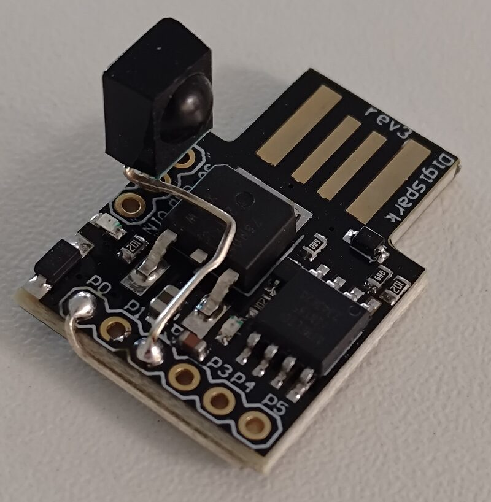
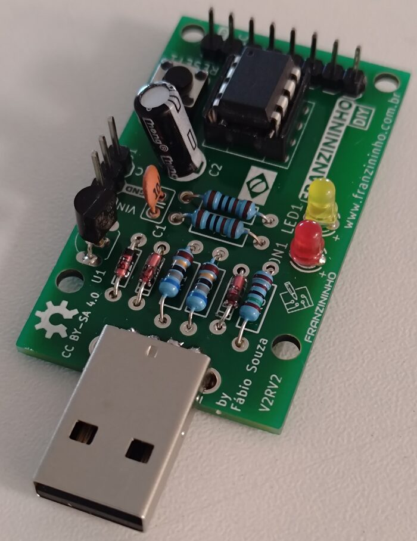

# DigiMacro

**English** · [Português](README.pt-BR.md)

A morse-activated macro keyboard on an ATtiny85 Digispark, configured from a
web page.

Web configuration app: https://digimacro.postcogito.org

Presents itself to the host PC or smartphone as a USB keyboard. By tapping
on a touch pad in morse code, it types one of 62 possible keystroke sequences
you pre-program via the accompanying web page (requires Chrome or Edge on a
computer, or Chrome on Android: not Safari, and not an iPhone or iPad).
It can also be triggered by an infrared remote control if you add an infrared
sensor (TSOP4838 or similar).

It can also automatically type on power-up (that was actually the original
use case of the very first version many years ago: having an LG TV start
its built-in browser automatically when turned on.)

<p align="center">
  
</p>

*The whole thing: a Digispark, a bare wire on P0 bent round the edge of the
board as the touch pad, and — optional — a TSOP4838 IR receiver with its
output wired to P2.*

> ### ⚠️ Storing passwords or secrets? Read [HARDENED_MODE.md](HARDENED_MODE.md) first — all of it.
>
> Over the years I had people use this to automate typing passwords into
> all kinds of systems. I always warned them that it was a bad idea, but,
> since it didn't stop anybody, I decided to make it an officially supported
> feature and do the best I could to mitigate the obvious security problems.
> If that's what you want to do, read the above document in its entirety and
> do all it says. Even so, I accept no responsibility if your password/secrets
> ever leak.
>
> **At the very least, set a password.** A board without one takes new
> firmware from anyone in the six seconds after it is plugged in, and
> firmware that types out every macro takes seconds to write.

v1 of the firmware and the page is at tag `v1.0`, kept for history. It is
entirely deprecated, and as far as I know there are none left in the wild:
v2 is better in every way. The page still offers to move a v1 board to v2.

## What you need

- **A Digispark** (ATtiny85) or a clone, as it comes: the page puts v2 on it
  through the Micronucleus bootloader it ships with, which v2 then replaces.
  Or any ATtiny85 board and an ISP programmer. The
  [Franzininho](https://franzininho.com.br/), a Brazilian Digispark, works
  as it is, with its pin header's P0 pin as the pad.
- **A touch pad on P0.** Any small piece of metal will do — a bare wire, a
  coin, a square of copper tape, or even the pin header that sometimes already
  comes soldered to the board — and no other parts are needed. A pushbutton
  from P0 to ground works too (`make BUTTON=1`), as does a pad read
  through a bleed resistor of about 1 MΩ (`make RC=1`).
- **The board's LED on P1**, which is where the Digispark has it. A clone with
  its LED on P0 needs `PIN_LED` changed in `DigiMacro.ino`, since P0 is the
  pad.
- **An optional IR receiver on P2:** a TSOP4838 or any of its kind, with
  its output on P2, lets a remote control that speaks NEC — most cheap ones
  do — start macros. Nothing else is needed, and a board without one is no
  different.
- **Chrome or Edge on a computer, or Chrome on Android:** WebHID — and
  WebUSB, to reach Micronucleus when a board is set up — are not in Firefox
  or Safari, and every browser on an iPhone or iPad is Safari underneath.
  Chrome on Android has WebUSB but no WebHID, so there the page reaches the
  board through WebUSB alone, over a USB OTG adapter; that needs core 4 (*It
  never stops being a keyboard*, below). A board set up before core 4 keeps
  its older core, which only a programmer rewrites (*With a programmer*):
  save a backup first, since that erases the EEPROM. Tested on Linux, on
  Windows 10 in a virtual machine and on Android, setting a board up
  included; macOS should work the same way in Chrome or Edge, needing
  nothing installed, but nobody has tried it yet. Android puts its own on-screen keyboard away while the board
  is plugged in, since the board is a keyboard, so the page brings one: ⌨ at
  the top, on by default on a touch screen. The board itself types into
  anything that takes a USB keyboard, phones included; only setting it up
  needs the page.
- **To install it,** nothing but the page: the released firmware is committed
  in `web/firmware/`.
- **To build it,** `make`, `python3` and avr-gcc, on Linux. The Makefile looks
  for the avr-gcc the Arduino AVR core installs under `~/.arduino15`; `make
  AVR=/path/to/bin/` points it elsewhere. The tests also need `gcc`, `g++` and
  `node`.

<p align="center">
  
</p>

*A [Franzininho](https://franzininho.com.br/) DIY. Touching P0 on its pin
header is all the pad it needs.*

## Getting started

1. **On Linux, let the browser reach the board.** Every hidraw and USB device
   is root-only until a udev rule says otherwise:
   ```
   sudo cp web/60-digimacro.rules /etc/udev/rules.d/
   sudo udevadm control --reload
   ```
   On Windows, Micronucleus needs a driver once, for setting a board up: run
   [Zadig](https://zadig.akeo.ie/) while the board sits in its bootloader, the
   first few seconds after plugging it in, and install WinUSB for it (the
   page says so if Windows refuses it). Configuring a board that is already
   set up needs nothing installed, on Windows or anywhere else: the page
   talks to it over HID, or over WebUSB on Android, and neither wants a
   driver. macOS and Android need nothing even for setting a board up.
2. **Open the app.** Point your browser to:

   https://digimacro.postcogito.org/

   Or serve it yourself. WebHID needs a secure context, and `localhost`
   counts:

   ```
   cd web && python3 -m http.server 8000
   ```

   Then open `http://localhost:8000/`. Any https host serving
   `web/` works the same way.
3. **Put v2 on the board.** A Digispark as it comes, unplugged: press **Set
   up a new board**, plug the board in while the browser's list is open, and
   pick it as soon as it shows up, as *Digispark* or *Micronucleus*. After
   that the board comes back as DigiMacro but with no firmware yet, and the
   page offers to install it — see *Setting a board up* below. With a
   programmer instead: see *With a programmer*.
4. **Connect.** Pick the board, then **hold the pad for four seconds**. The
   page reads everything the board holds by itself; if the board has a
   password, type it and press Unlock.
5. **Write some macros**, press **Write to the board**, and tap a code into a
   text editor.

## Tapping

A press shorter than a quarter of a second is a dot, and a longer one is a
dash. 700 ms of silence ends the code. A code is one to five symbols, so 62
codes exist. Holding the pad for four seconds taps nothing; it opens the
window during which the app may read and write the table, for half a minute.

Touching the pad stops whatever is playing. The pad is read between
keystrokes — a touch reading is a quarter of a millisecond against a
keystroke's twenty — and during pauses, so even a macro that jumps to itself,
which runs for ever by design, stops when touched. That press is not also
counted as a symbol, and holding it on opens the window, so a runaway is
stopped and repaired with one gesture. The one loop that touch cannot stop is
one that never types or pauses at all. The firmware bounds that by counting
jumps, and the app refuses to write one.

### What the LED says

| LED | means |
|---|---|
| off | idle, and also while you tap a code, so it does not spell the code out for anyone watching |
| on, steady | a macro is typing or pausing; touch the pad to stop it |
| three quick blinks | the code matched nothing |
| slow blink, once a second | the window is open: the app may read and write the table for half a minute |
| a short blip every two seconds | soft lock: too many wrong codes, so every tap is ignored until the wait is over |
| fast flicker, eight times a second | hard lock: every tap is ignored until the password is given in the app |

The window's blink wins over both locks, so you can see the hold took while
the board is locked.

## The app

`web/index.html` shows one thing at a time:

- **Nothing connected:** only Connect.
- **Connected:** the hold, and the password if the board has one, typed before
  or after the hold, as you like.
- **In:** everything the board holds, already read.

**Write to the board**, at the right of the status line, is enabled only when
what is on screen differs from what the board holds, compared as the bytes
that would be written. Every other action reports on a line under its own
button. The window lasts half a minute and editing takes longer, so when it
has lapsed an action asks for the hold again, waits for it, and gives the
password again by itself. The page keeps the password only while the board
stays plugged in.

The sections are **Macros**, with the keyboard layout picker beside the
heading; **Keys**, a palette that inserts anything below at the cursor;
**Startup**; **Host**; **Password**; **Lockout**; and **Backup**. The
table's headings are links: **Code** explains codes and has a Morse table to
pick memorable ones from, and **Types** is the reference for what a macro
can hold. The app
speaks English and Brazilian Portuguese, picked from the browser and changed
at the top right.

### Writing macros

A macro is text, with braces for what text cannot say:

```
 hello{Enter}                 anything is typed as itself
 \n  \t  \\  {{               newline, tab, backslash, a literal {
 {Ctrl+c}  {Alt+Tab}  {F5}    modifiers, and keys that are not characters
 {pause 1.5}                  wait, in seconds
 x{11}                        eleven of them, as in a regular expression
 (ab){3}                      ...of a whole group rather than one thing
 {goto .-}                    carry on with another macro, and never come back
 {host}  {host!}              stop unless this computer sent the host key lately
 {IR 00 45}                   where the remote's button 00 45 starts typing
```

`{11}` means eleven in all, as a quantifier does in a regular expression, and a
count counts whatever precedes it: one keystroke, one accented letter, or a
bracketed group. A parenthesis is only a parenthesis unless a count follows
the closing one.

The editor encodes as you type, so a mistake is reported beside the macro
that has it, and the byte budget — 480 in all — is always on screen. Nothing
is written until every macro is valid.

**Accented characters are the host's business, not the board's.** The board
sends key presses, so what appears depends on the keyboard layout of the
computer it is plugged into. Pick that layout beside the Macros heading and
`coração` is accepted and expanded into the accent and then the letter. Leave
it at plain US, where there is no way to type one, and the editor says so
rather than typing something else.

### The remote

With an IR receiver on P2, a button on a remote starts typing just after its
`{IR}`, wherever in a macro that is, and goes on to the end of that macro.
Tapped by its code, the same macro types straight through the `{IR}`, which
does nothing. A macro can hold several, so one macro can be a menu of
starting points.

A macro that only the remote should reach gets a code from `IR1` to `IR30`
instead of dots and dashes. No tapping makes those codes, so no tap and no
guess ever types it; a `{goto IR1}` still can.

To find a button's two bytes, press **remote button** in the key pad. A
dialog opens and the board types the next button it sees, within ten seconds,
into a box there; the page turns it into `{IR 04 08}`, with a button to copy
it, ready to paste where that button's typing should start. The box reads keys
by position, so it is not fooled by a keyboard layout that puts other
characters on the digits. That needs neither the hold nor the password: all it
can do is type one button as hex.

Buttons that are not in the table do nothing at all, and never count toward
the lockout: rooms are full of other people's remotes. A locked board ignores
the remote, as it ignores taps, and a `{host}` check holds wherever the
remote starts. Holding a button plays its macro once. The receiver is
optional, and `HAVE_IR 0` in `DigiMacro.ino` builds without it.

A remote that **remote button** never hears is one the decoder cannot read:
`make irspike` (*Building*) shows what the receiver gets from it. That is how an
LG TV's remote turned out to be NEC after all, with a leader the receiver
had cut short; firmware 15 takes it.

### Startup

One macro can type itself when the board is plugged in. It is stored as the
code rather than a position in the table, so reordering the macros cannot
point it somewhere else, and a code that is no longer there types nothing.
It is a setting rather than a macro, so it has a Save of its own; it waits
while the table has a macro still to write that it would name, and writing a
table that drops the startup macro's code clears it.

It waits for the host to have somewhere to put the keystrokes, which is not
the same as being plugged in. The host reads the descriptors early and
attaches a keyboard to its input stack some time later, and a macro that
started in between would lose however much of itself fitted in the gap. So
the board waits for the host to send it a lock-light report — the host
talking *to* the keyboard, which it only does once there is one — and gives
up waiting after a second and a half in case a host never does.

## Security

What follows is layered, optional, and absent on an erased chip: a board that
types eleven right-arrows at a television should not ask anybody for
anything. Without a password none of it protects the EEPROM from someone with
the board and a laptop, since the board takes new firmware from anyone in the
seconds after a replug. With one, an update needs it too; a programmer still
reads the chip unless it is hardened. [HARDENED_MODE.md](HARDENED_MODE.md)
sets out what each layer stops and what it does not.

### The hold

Reaching the table needs the four-second hold, which no web page or program
can do for itself. On a board with no password, it is the only thing between
a hostile page and the macros.

### The password

A *second* gate on the table, and the only gate on the firmware. The window
says somebody is at the board; the password says they are the right
somebody, which a thief holding the board is not. It does not gate *playing*
a macro: a device that wants a password before it will type is a device
nobody would carry.

The board's core checks it, not the firmware, because it guards updates even
when there is no firmware to ask — after an update cut off half way, say,
when the EEPROM still holds every secret. Setting, changing and removing it
are the firmware's.

A wrong answer costs a second, and with the lockout on it counts as a wrong
code — with firmware running. With only the core, after an update cut off,
it has no lockout to count against, and the second is all that limits
guessing: one more reason for twelve characters. That is all: the password is never refused for being locked, because it
is what lifts a hard lock, and a limit on it is the one lock that can shut the
owner out too. Its defence against guessing is its own length, up to twelve
characters. The comparison runs to the end whatever happens, so its timing
says nothing about how much of the answer was right. The unlock lasts as long
as the window and lives in RAM, so unplugging the board locks it again. With
only the core running, there is no window: the core ends the unlock itself
after about seven seconds without a page of firmware arriving, so a board
left half updated does not stay open.

### The lockout

It needs the password, since giving the password is the only way to lift a
hard lock. Two stages, so that the owner can fumble a code without needing
the app:

- **Soft lock.** After a set number of wrong codes, the board ignores every
  tap, right or wrong, for a set time: a minute by default, up to forty.
- **Hard lock.** After a set number of soft locks in a row, it ignores taps
  until the password is given in the app. The power-on macro stops too, or a
  thief would only have to plug the board in again.

A macro that actually plays clears both counts. So someone guessing gets at
most *wrong codes × soft locks* tries before the board stops listening, which
at 1 and 3 is three, out of 62 codes. The app works out those odds for the
settings you choose.

Everything is kept in EEPROM, so unplugging the board gets nobody anywhere.
The board has no clock to tell it how long it was unplugged, so a soft lock
found at power-up starts its whole wait again. A wrong code is counted
*before* the three blinks that report it, so pulling the plug as soon as the
blinks start saves nothing. A code that plays writes nothing unless there is
a count to clear, so ordinary use causes no EEPROM wear.

### Trusting the host

A USB device has no idea which computer it is plugged into, so a board that
types a password types it for whoever holds it. For a computer whose software
you control, there is an answer: a small client there sends the board a key,
and for a while afterwards — a minute by default, up to forty — macros
guarded by a host check play. Plugged into any other computer, they stop.

```
 {host}      stop here, quietly, unless this computer sent the key lately
 {host!}     stop as if the code were not in the table at all
```

`{host!}` is the one that matters against a guesser. Refused, it looks exactly
like a code that is not there — three blinks, and a wrong code for the
lockout — so on the wrong computer a guarded code cannot be told from an
empty one. That holds only if nothing shows before the check, which the app
warns about. The LED stays dark until a macro types or pauses, for the same
reason: a flash on the way in would give the code away. `{host}` may go
anywhere, for a macro that types a user name and then stops short of the
password. A refused macro does not count as a code that worked, so tapping a
guarded code on the wrong computer does not clear a guesser's misses.

The key is eight random bytes, made in the app's Host section, written to the
board, and downloaded as a file named after the board's serial number. The
client is `tools/hostauth`, one C file with no library, for Linux and
Windows. Both are ready-built on the
[releases page](https://github.com/marcocarnut/DigiMacro/releases):
`digimacro-host-linux-x86_64`, statically linked so it runs on any
distribution, and `digimacro-host.exe`. On Linux it needs the same udev rule
as the app. Built from source:

```
make -C tools/hostauth install            # into ~/.local/bin
mkdir -p ~/.config/digimacro
cat ~/Downloads/digimacro-*.key >> ~/.config/digimacro/host.key
chmod 600 ~/.config/digimacro/host.key
digimacro-host                            # once
digimacro-host -e 30                      # every 30 seconds, for as long as it runs
```

For Windows, take `digimacro-host.exe` from the releases page, or let
`make -C tools/hostauth windows` cross-compile it with MinGW-w64
(`gcc-mingw-w64-x86-64` on Debian and Ubuntu). It is a single file needing nothing installed beside it, and it reads
its keys from `%APPDATA%\digimacro\host.key`:

```
mkdir "%APPDATA%\digimacro"
type digimacro-*.key >> "%APPDATA%\digimacro\host.key"
digimacro-host.exe -e 30
```

To keep it running while you are logged in, put a shortcut to
`digimacro-host.exe -e 30` in the Startup folder (`shell:startup`).

Run with `-e` from your session, and stopped when the screen locks, the trust
becomes "while I am logged in". The client finds every board plugged in by
its serial number, so one key file serves several boards. `-k` names another
key file; on Linux the default honours `$XDG_CONFIG_HOME`.

Sending the key needs neither the hold nor the password, because nobody is
at the board — like INFO, and reading the flash, which holds nothing secret.
So it can do nothing else:
it opens no window, unlocks nothing and reads nothing, and a wrong key does
**not** count against the lockout. If it did, any program on any computer
could hard-lock the board without anyone touching it. A wrong key costs a
second instead, on a clock of its own.

### Backups

**Backup** saves the board's whole EEPROM to a file — macros, startup,
lockout, host key, password and serial number — and **Restore** puts it back,
so a board erased by a programmer comes back as itself, Chrome's permission
and host key files included. v1 and v2 keep the same EEPROM map, so a v1
board's backup restores onto a v2 one. The password goes in last, or the board would lock
itself half way through its own restore, and the lockout's wrong-code and
soft-lock counts start again. Then the board restarts itself — leaves the bus and comes back, as if
replugged — because the serial number is only sent when the board is plugged
in, and a restored one is easy to forget about. To Chrome a new serial is a
new device, so the page asks you to press Connect and pick the board again.
Firmware older than 8 cannot restart itself, and the page asks you to replug
it instead.

On a board with a password, the file is encrypted with it: scrypt with BIP38's
parameters derives the key, and AES-256-GCM encrypts the image and says
plainly when the password is wrong. Browsers have no scrypt, so `web/backup.js`
writes it out, and a test checks it against node's own and RFC 7914's
vectors. A copied file can be guessed at offline, with no hold and no
one-second wait, so a password under eight characters gets a warning first;
a board with no password backs up in the clear, after a warning too. Restore
takes the whole image, whatever board it came from, so restoring one board's
backup onto another gives the second the first's identity.

### Every board has a serial number

Four random bytes, made once by the firmware's first start on a chip that has
never had one and kept in EEPROM, rendered as eight hex digits after
`postcogito.org:`; the core reads them each time the host asks. Until the
firmware has made one — a new board with only the core on it — the serial is
`FFFFFFFF`, and Chrome sees a new device once more when it changes. The prefix is
obdev's rule for `16c0:27db`, the shared ID for keyboards told apart by serial
number: the serial must begin with a domain the author owns, so that devices
from different people on the same ID cannot be confused. Chrome remembers a WebHID permission
only for a device that has a serial number, so without one every replug would
mean picking the board out of the chooser again. Making it per board rather
than per model means two boards get their own grants, and their own host keys.

The randomness comes from the watchdog oscillator's jitter against the CPU
clock: two independent RC oscillators, so the low bits of a timer sampled at
each watchdog timeout are unpredictable. It takes about a second, once in a
board's life.

## Updating the firmware

The status line shows the board's firmware version, followed by **(latest)**,
or by **(update…)** when the page carries something newer — *(update
available)* until the hold has let the page in; that opens a dialog with the
update in it. Press **Update the firmware** with the window
open, or hold the pad when it asks: the page writes the new firmware over the
same connection, a page of flash at a time, and the board restarts into it a
few seconds later and asks for the hold again. No bootloader, no second
picker, no driver. The macros, the password, the lockout, the host key and
the serial number all live in EEPROM, which an update leaves alone.

- **Six seconds.** While firmware runs, the core takes the first page of an
  update only in the six seconds after the board was plugged in, as
  Micronucleus did — or after the firmware opens that window again, which
  the page asks it to do behind the hold and the password. With a password
  set, the core wants it as well, either way.
- **Cut off half way**, by a cable pulled or a page closed, the board has no
  firmware to run: the core erased the old one's header first, so it never
  runs half of one. It comes back as DigiMacro with only its core, and the
  page says **DigiMacro is not running on this board** and offers to install
  it again — behind the password, if the board has one, and nothing else.
  Left plugged in with the page closed, the board ends its unlock by itself
  after about seven seconds.
- **Firmware that stops answering** for two seconds is reset by the
  watchdog — and firmware that crashes, jumping back to the start — and the
  core does not start it again: the page shows the same view. Unplugging the
  board and plugging it back in gives it another try.
- **Another tab or program talking to the board** at the same time does no
  harm: the page only trusts an answer to its own question, and checks every
  page it writes by reading it back.

### Setting a board up

**Set up a new board**, beside Connect, puts v2 on a Digispark as it comes.
Press it with the board unplugged, plug the board in while the browser's list
is open, and pick it as soon as it shows up: Micronucleus waits only a few
seconds, and a 1.x board left past them stays on the bus but no longer answers
until it is plugged in again. The page writes v2's core through it. The board
then comes back as DigiMacro with only its core — serial `FFFFFFFF` until the
firmware makes one — and **Connect** leads to the install. The firmware goes
on over Micronucleus itself, and at its first page the core takes back the
reset vector Micronucleus had pointed at itself, so Micronucleus is never run
again. A power cut in those few milliseconds needs a programmer to put right,
the same risk as any upload through Micronucleus; it happens once in a board's
life.

**A v1 board** moves the same way: connect it, and **(move to v2…)** in the
status line opens the firmware dialog. The board restarts into Micronucleus,
takes the core, and comes back asking for the firmware. Its macros, password, host key and serial number
come along: v2 keeps v1's EEPROM map.

Micronucleus is reached over WebUSB: Linux needs its line in
`web/60-digimacro.rules`, and Windows needs [Zadig](https://zadig.akeo.ie/)
once, run while the board is in Micronucleus, to install WinUSB for it.

### With a programmer

`web/firmware/digimacro-v2-full.hex` is the core and the firmware in one
image, with the fuses a v2 board wants:

```
avrdude -c <programmer> -p t85 -e -U flash:w:web/firmware/digimacro-v2-full.hex:i \
        -U lfuse:w:0xe1:m -U hfuse:w:0xdd:m -U efuse:w:0xfe:m
```

Low `0xE1` is the Digispark's clock (`0xF1` works as well); high `0xDD` turns
on brown-out detection, which a chip that writes its own flash wants;
extended `0xFE` keeps SELFPRGEN, without which the board cannot update itself.
The erase takes the EEPROM with it: back up first. Hardening goes further:
[HARDENED_MODE.md](HARDENED_MODE.md).

### v1 boards

The only update a v1 board gets from the page is the move to v2: v1 is frozen
at firmware 9, and v2 does everything it did. The board restarts into its
bootloader and the browser asks you to pick it — a second picker, plain
vendor class over WebUSB.

- **Pick it within a few seconds.** The bootloader waits about six and then
  goes back to the old firmware, so the click that starts the move has to
  find the window already open. If it is not, that click asks for the hold,
  and the next click does the move.
- **Firmware older than 3** cannot restart itself into the bootloader, so it
  needs the core written by hand: `micronucleus --run
  web/firmware/digimacro-v2-core.hex`. Plug the board in, and the page
  installs the firmware.
- **A hardened v1 board** has no bootloader, and says **(hardened)** instead,
  or **(not fully hardened…)** with a list of what is missing — *(hardened:
  no bootloader)* on firmware older than 8.
- v1's REBOOT command sits behind the window and the password: a board in its
  bootloader can be flashed with anything.

The uploader is [DigiISP](https://digiisp.postcogito.org)'s, ported to plain
JavaScript in `web/micronucleus.js`.

### Releasing

A new firmware reaches the page through `make release`, which copies the
build into `web/firmware/` with a json naming its version and the core it is
for: `digimacro-v2.hex` for updates, `digimacro-v2-core.hex` for setting a
board up, `digimacro-v2-full.hex` for a programmer. Commit them, and the page
offers the update to every board running something older — only if its core
speaks the same API. The page carries the files itself, so serving it needs
no AVR toolchain.

What gets published goes into `build/release/`: `make site` builds the page
as one file, `index.html`, with its scripts and the firmware inside it, and
`make hosts` builds `digimacro-host-linux-x86_64` (static) and
`digimacro-host.exe`. The page is all the website needs; the two clients go
on the GitHub release.

## How it works

### It never stops being a keyboard

A HID keyboard is not something a browser will talk to: Chrome refuses
protected HID usage pages, keyboards among them. So the board carries a
second top-level collection on a **vendor usage page**, `0xFF00`, which WebHID
does hand over, while the keyboard half carries on being a keyboard. HID
needs no driver anywhere, so Windows needs nothing installed.

It cost two things. The keyboard gave up boot protocol, since two collections
on one interface need report IDs and a boot report may not have one, which
also caps it at three key slots rather than six — nothing that presses one key
at a time notices. And there is no landing page: Chrome offers one for a
WebUSB device, not a HID one. An earlier version re-enumerated as a WebUSB
device after the hold, and back again afterwards; v1's design record tells
that story (`git show v1.0:PLAN.md`).

Chrome on Android has no WebHID at all, and WebUSB will not claim a HID
interface, nor take a request addressed to the device in its stead. So
core 4 adds a second interface, vendor class and no endpoints, which WebUSB
does claim. The board takes the same feature report sent to it, since the
core looks at the request and not at the interface it was sent to, and the
page (`web/webusb.js`) dresses WebUSB up as WebHID where there is no WebHID.
On Windows, where no driver claims the new interface, Device Manager shows
the board with a yellow mark; the keyboard and the page carry on regardless.

### The core and the firmware

The flash is split at `0x1000`. Below it, the **core**: V-USB and the
descriptors, the feature report, the password check, and the page writer
that takes new firmware and refuses any address below the boundary. It is
never rewritten from USB, so it is kept small and dull, and tested on the
host harder than anything else. Above it, the **firmware**: the pad, morse,
the table, playback, the lockout, the host check, the clock and the window.

They call each other through two tables of jumps at fixed addresses — the
core's just below the boundary, the firmware's header at it — and agree on
nothing else; `core/layout.h` is the whole contract. The firmware's header
carries a magic, its length, its version and the core API it was built for,
and a CRC follows it: the core runs only firmware that checks out. Every
interrupt but V-USB's is passed on to the firmware, and the watchdog watches
it. v2's design record tells how it was decided and why: it was retired once
everything in it was built, and `git show ae7e0ac:PLAN-v2.md` has it.

### The protocol

One 36-byte feature report on the vendor collection, both ways. Set it to ask,
and get it to see the answer:

```
 [0] command   [1] address low   [2] address high   [3] count   [4..35] data
```

Protocol 3, which v2 speaks. The core answers INFO, PAGE, FREAD and COMMIT,
and UNLOCK when there is no firmware; the firmware answers the rest.

| | |
|---|---|
| `0x40` INFO | always answers: `[1..2]` "DM", `[3]` protocol (3), `[4]` the core's version, `[5..6]` EEPROM size, `[7]` state, `[8..11]` the low, high and extended fuses and the lock byte as the chip reads them, `[12]` the core's state (below), `[13]` the firmware's version, 0 for none, `[14]` the core's API, `[15..18]` where the firmware may go, `[19]` the flash page size. With no firmware running, the firmware's parts — `[5..6]`, and all of `[7]` but the password bits — read 0 |
| `0x42` RESTART | off the bus and back, as if replugged, without a reset: the serial number is read again, so a restored one takes effect. The window closes, the host's trust is forgotten, and the power-on macro does not type; the six seconds for an update do not start again |
| `0x60` READ | address and count in, up to 32 bytes of EEPROM back |
| `0x61` WRITE | address, count and up to 32 bytes in |
| `0x62` UNLOCK | the password, if the board has one |
| `0x63` SETPASS | a new password, or none at all with a count of 0 |
| `0x64` HOSTAUTH | the host key. Needs neither the window nor the password, and does nothing else |
| `0x65` PAGE | half a page of new firmware, 32 bytes at an address; the second half writes it |
| `0x66` FREAD | flash, up to 32 bytes: published firmware, so no gate. Refused while a page waits to be written |
| `0x67` COMMIT | the new firmware checks out: start it |
| `0x68` UPDATE | the firmware opens the update window: six seconds for the first PAGE |
| `0x69` LEARN | the next remote button, within ten seconds, is typed as two hex bytes rather than played |
| `0xEE` | comes back in place of the command when a request is refused: the window is shut, the password has not been given, the password or host key is wrong or came within a second of a wrong one, or the command is not one there is |

INFO, HOSTAUTH, FREAD and LEARN need no gate. PAGE needs the password if one is set,
and with firmware running, the update window; COMMIT needs only pages taken
and firmware that checks out. UNLOCK needs the window — and with only the
core, nothing at all. Everything else needs the window, and the password if
one is set. INFO's state byte:

| bit | |
|---|---|
| `0x01` | the window is open |
| `0x02` | a password is set |
| `0x04` | ...and has been given, or there is none |
| `0x08` | soft lock |
| `0x10` | hard lock |
| `0x20` | the host sent its key lately |
| `0x40` | there is a host key |
| `0x80` | v1 only: built with no bootloader |

and the core's, in `[12]`: `0x01` firmware running, `0x02` taking pages,
`0x04` firmware there but not started — the watchdog reset it, or it
crashed.

READ and WRITE reach the whole EEPROM, reserved bytes included — that is how
the app writes the settings, and why they sit behind both gates. A read past
the end returns `0xFF`, and a write past it stops. Writes go 32 bytes at a
time because an EEPROM byte takes 3.4 ms and the device can answer nothing
else while it writes. They use `eeprom_update_byte`, so a table saved
unchanged costs no wear.

The board has one report for everybody, so another program asking between a
question and its answer would have the answer read as its own. The page asks
again unless the answer echoes its command and address.

Whether the report ID travels in the payload as well as in the request is the
one thing the HID specification leaves to taste. Chrome does not send one
back; the app looks rather than assuming, and the firmware accepts either,
which is safe because no command byte is 2.

v1 (protocol 2) differs in INFO — `[4]` is its firmware's version, and
`[12..19]` are not there — has `0x41` REBOOT into Micronucleus, and none of
PAGE to UPDATE.

### The table

The app rewrites the whole table, so entries are packed rather than slotted:

```
 [hdr][keystroke...][0x00]      repeated, in any order
 [0xFF]                         end of table
```

`hdr` is the code: three bits of symbol-count-minus-one, five bits of symbols,
a dash being a 1 and the first symbol in the highest bit that count uses. No
count above five exists, so `0xFF` ends the table and **a virgin chip reads as
an empty one** — nothing to initialise. Two bytes of overhead per macro, and
480 bytes to divide up however you like.

A keystroke is a HID usage rather than a character, because the app does the
layout mapping:

```
 bit 7     needs Shift
 bits 0-6  HID usage
```

Usages `0x01`–`0x03` are states a keyboard reports, never keys anyone
presses, so those three values are free to be escapes, and so are the same
three with bit 7 set, and `0x80`, Shift with no key at all. Hence the test
for an escape: a byte whose low seven bits are below four. All seven are
taken:

| | |
|---|---|
| `0x01 nn` | pause `nn` tenths of a second |
| `0x02 mm` | latch HID modifier mask `mm` into the next keystroke |
| `0x03 nn` | do the previous keystroke `nn` more times |
| `0x81 hh` | carry on with the macro whose header is `hh-1` |
| `0x82` | mark: what follows repeats as a group, not as one keystroke |
| `0x83 nn` | stop unless the host sent its key lately: quietly if `nn` is 1, as an empty code if 2 |
| `0x80 a c x` | where the remote's button `a`/`c` starts this macro: `a` and `c` with bit 7 forced on, `x` = `0x80` plus their own top bits (`a`'s in bit 0, `c`'s in bit 1). Played through, it does nothing |

No argument may be zero, since a zero byte ends the macro. `0x03` is
run-length coding: "left arrow eleven times" costs three bytes rather than
eleven, and repeating *whatever went before* carries the latched modifiers with
it. `0x82` is what keeps that working once a keystroke stops being a
character: on a dead-key keyboard `ç` is two presses, the accent and then the
letter, so repeating "the previous keystroke" alone would type `çcccc`. A mark
says where the repeated thing began. It takes no argument — its position is
its argument — and marks do not nest.

This is the interface between the firmware and the app, so neither end is
trusted on its own: `web/table.js` is one original, shared by the app and a
test that plays what it encodes through the real firmware, and another test
reads the escape values out of `DigiMacro.ino` and checks the two agree.

### The EEPROM

| | |
|---|---|
| `0x000`–`0x1DF` | the macro table |
| `0x1E0`–`0x1E3` | the serial number |
| `0x1E4`–`0x1EB` | the host key; all `0xFF` for none |
| `0x1EC` | lockout: wrong codes before a soft lock; 0 or `0xFF` for no lockout |
| `0x1ED` | ...soft locks in a row before a hard lock; 0 or `0xFF` for never |
| `0x1EE` | ...a soft lock's length in tens of seconds, 1–240; anything else is 6 |
| `0x1EF` | ...wrong codes so far |
| `0x1F0` | ...soft locks in a row so far |
| `0x1F1` | ...hard locks lifted with the password, ever |
| `0x1F2` | how long the host stays trusted, in tens of seconds, 1–240; anything else is 6 |
| `0x1F3` | the power-on macro's header; anything impossible as one means none |
| `0x1F4`–`0x1FF` | the password, zero-padded; `0xFF` in the first byte for none |

The three lockout counters are stored inverted, so an erased byte reads as
zero. The reserved block is full: anything more will have to come out of the
table.

## Building

```
make                            # the core and DigiMacro, into build/v2/
make release                    # ...and into web/firmware/, for the page
make test                       # the core's own tests
```

`make` writes `digimacro.hex`, the firmware for updates, and
`digimacro-full.hex`, the core and the firmware for a programmer. Options,
each `=1`:

- `BUTTON`: a pushbutton from P0 to ground instead of a pad.
- `RC`: a pad read through a bleed resistor rather than the chip's pull-up.
- `LEDECHO`: the LED follows the input while tapping. For working on the
  input path only, since it shows a bystander the code.
- `TOUCHDEBUG`: the board types its own pad readings twice a second, the only
  diagnostic channel a device with no serial port has. `web/README.md` says
  how to read them.

`make release` takes none: it is the stock firmware. `make spike` and `make
page` build what proved v2 before DigiMacro moved onto it — a core that keeps
below Micronucleus, three small apps, and a page that swaps them — into
`build/v2-spike/`.

`make irspike` builds the IR spike, `app/irspike.c`: an app in place of
DigiMacro that types every frame the receiver sees, as microseconds of
carrier and silence, into whatever has the focus. `irspike.hex` goes on
through that spike page's file picker (the board keeps its table), or
`irspike-full.hex` through a programmer; it leaves the window open, so the
page puts DigiMacro back with no hold.

## Testing

```
test/run.sh
```

compiles the real `DigiMacro.ino` for the host against stub hardware and
exercises the table walk, every escape, the bounds that keep a malformed table
from reaching the reserved bytes, the morse decoding from the input pin, the
password, the lockout and the host check, and both ways of reading the pad.
Then the app's macro language on its own; the two languages against each
other; v2's core laid out for Micronucleus, with both jumps decoded and
followed to where they land; the page's updates against a fake v2 board that
halts, reads back old pages, is interrupted by another program and is
unplugged half way; WebUSB standing in for WebHID, against another; the page's
own keyboard, every key held to what the board can type; the core itself,
compiled for the host with the firmware's library and asked everything a host
can ask, twice — with the firmware's region to the end of the chip and
stopping below Micronucleus; the backups, with scrypt checked against node's
own and a file that opens only for its password; the published page, one file
with the firmware in it; and last, across the language boundary, a table
encoded by `web/table.js` played through the firmware. Thirteen suites, a few
seconds. Without `node`, the nine that need it are skipped.

## Layout

| | |
|---|---|
| `DigiMacro.ino` | the firmware: touch, morse, the table walk, playback, the lockout, the host check |
| `app/` | what every firmware links: its header, the calls into the core, and `hidusb.c` — the clock, the window, typing and the protocol's verbs. Also the spike's apps, `spikectl.py` and its page |
| `core/` | the core: V-USB with its configuration, the descriptors, the password check and the page writer; `layout.h`, the contract with the firmware; and its host tests |
| `Makefile` | builds all of it |
| `test/` | host build of the real sketch against stub hardware, and the web side's tests |
| `tools/hostauth/` | the client that sends the host key, for Linux and Windows |
| `web/` | `index.html` is the app, `hid.html` a raw protocol page for developers, `table.js` and `i18n.js` what they share, `coreupdate.js` updates v2 boards, `micronucleus.js` reaches Micronucleus, `webusb.js` reaches the board without WebHID, `vkbd.js` the on-screen keyboard, `backup.js` the backups, `60-digimacro.rules` the udev rule |
| `web/firmware/` | what the page installs: v2's firmware, core and full image |
| `docs/` | the photos above |
| `HARDENED_MODE.md` | how to make a board fit to hold secrets, and what that still does not protect |
| `*.pt-BR.md` | this README and HARDENED_MODE.md in Brazilian Portuguese |

## Related

- [DigiISP](https://digiisp.postcogito.org) turns a Digispark into an AVR
  programmer from the browser. It is what hardened mode is set up with, and
  where the Micronucleus uploader and the serial-number trick came from.
- [V-USB](https://www.obdev.at/products/vusb/) is the USB stack, and
  [Micronucleus](https://github.com/micronucleus/micronucleus) the bootloader
  v1 used and v2 is set up through.

## Licence

Copyright © 2026 Marco Carnut. GPLv2, following V-USB; see `LICENSE`.
