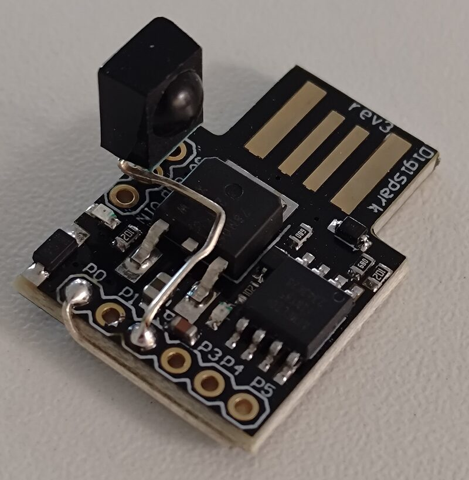
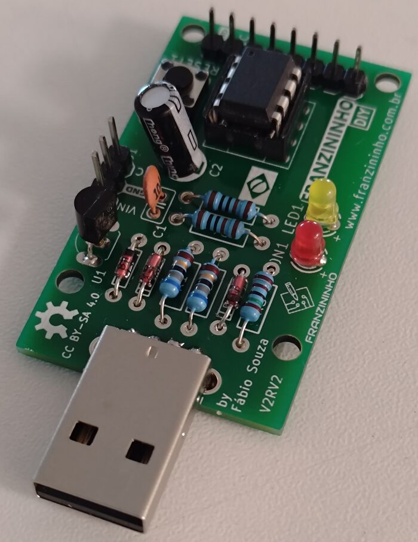

# DigiMacro

[English](README.md) · **Português**

Um teclado/mouse de macros acionado por código morse, num Digispark ATtiny85,
configurado por uma página web:

- https://digimacro.postcogito.org

Para o PC ou o celular, ele se apresenta como um teclado e mouse USB. Usando
código morse em um sensor de toque, você seleciona uma entre 62 possíveis
sequências de teclas e movimentos de mouse para serem executadas, pré-programadas
pela página web que o acompanha (precisa do Chrome ou
do Edge num computador, ou do Chrome no Android: não do Safari, e não num
iPhone ou iPad).

Também pode ser acionado por um controle remoto compatível com o protocolo NEC,
se você acrescentar um sensor de infravermelho (TSOP4838 ou similar).

Ele também pode digitar sozinho ao ser ligado (esse foi, aliás, o uso
original, muitos anos atrás: fazer uma TV LG abrir o navegador embutido
automaticamente ao ser ligada.)

E pode digitar o código de seis dígitos que um aplicativo autenticador
mostra, a partir de um relógio que ele mantém em sincronia com o do
computador.

<p align="center">
  
</p>

*É só isso: um Digispark, um fio nu no P0 dobrado pela borda da placa como
sensor de toque e — opcional — um receptor de IR TSOP4838 com a saída ligada
ao P2.*

> ### ⚠️ Vai guardar senhas ou segredos? Leia antes o [HARDENED_MODE.pt-BR.md](HARDENED_MODE.pt-BR.md) — inteiro.
>
> Ao longo dos anos, vi gente usando isto para automatizar a digitação de
> senhas em todo tipo de sistema. Sempre avisei que era má ideia, mas, como
> isso nunca deteve ninguém, decidi tornar o uso oficialmente suportado e fazer
> o melhor que pude para atenuar os problemas óbvios de segurança. Se é isso
> que você quer fazer, leia o documento acima por inteiro e faça tudo o que
> ele diz. Mesmo assim, não me responsabilizo se suas senhas ou segredos
> vazarem algum dia.
>
> **No mínimo, defina uma senha.** Uma placa sem senha aceita firmware novo de
> qualquer um nos seis segundos depois de conectada, e um firmware que digite
> todas as macros se escreve em segundos.

## Do que você precisa

- **Um Digispark** (ATtiny85) ou um clone, do jeito que vem: a página grava o
  DigiMacro nele pelo bootloader Micronucleus que vem de fábrica, que o
  DigiMacro depois substitui. Ou qualquer placa ATtiny85 e um gravador ISP. O
  [Franzininho](https://franzininho.com.br/), um Digispark brasileiro,
  funciona do jeito que vem, com
  o pino P0 da sua barra de pinos como sensor.
- **Um sensor no P0.** Qualquer pedacinho de metal serve — um fio desencapado,
  uma moeda, um quadrado de fita de cobre, ou até a barra de pinos que às
  vezes já vem soldada na placa — e nenhum outro componente é necessário. O
  firmware que a página instala só lê um sensor simples; o aplicativo de
  referência em C pode ser compilado para um botão do P0 para o terra (`make
  reference BUTTON=1`), ou para um sensor lido através de um resistor de
  dreno de cerca de 1 MΩ (`make reference RC=1`).
- **O LED da placa no P1**, que é onde o Digispark o tem. Um clone com o LED
  no P0 precisa de `PIN_LED` alterado em `app/asm/digimacro.S`, já que o P0 é
  o sensor.
- **Um receptor de IR opcional no P2:** um TSOP4838 ou qualquer outro do tipo,
  com a saída no P2, permite que um controle remoto que fale NEC — a maioria
  dos baratos fala — dispare macros. Nada mais é necessário, e uma placa sem
  ele não muda em nada.
- **Chrome ou Edge num computador, ou Chrome no Android:** WebHID — e
  WebUSB, para chegar ao Micronucleus ao preparar uma placa — não existem no
  Firefox nem no Safari, e todo navegador de iPhone ou iPad é Safari por
  baixo. O Chrome do Android tem WebUSB mas não WebHID, então lá a página
  chega à placa só por WebUSB, com um adaptador USB OTG (*Ele nunca deixa de
  ser um teclado*, abaixo). Uma placa preparada há muito tempo pode ter um
  núcleo sem a interface de que isso precisa: atualize o núcleo uma vez de um
  computador (*Uma placa num núcleo mais antigo*, abaixo), e daí em diante o
  Android chega a ela. Testado no Linux, no Windows 10 numa máquina virtual
  e no Android, inclusive preparando uma placa; o macOS deve funcionar do
  mesmo jeito no Chrome ou no Edge, sem instalar nada, mas ninguém testou
  ainda. O Android guarda o
  próprio teclado na tela enquanto a placa está conectada, já que a placa é
  um teclado, então a página traz um: ⌨ no alto, ligado por padrão numa tela
  de toque. A placa em si digita em qualquer coisa que aceite um teclado
  USB, celulares inclusive; só a configuração precisa da página.
- **Para instalar,** nada além da página: o firmware publicado está versionado
  em `web/firmware/`.
- **Para compilar,** `make`, `python3` e avr-gcc, no Linux. O Makefile procura
  o avr-gcc que o core AVR do Arduino instala em `~/.arduino15`; `make
  AVR=/caminho/para/bin/` aponta para outro lugar. Os testes também precisam
  de `gcc`, `g++` e `node`.

<p align="center">
  
</p>

*Um [Franzininho](https://franzininho.com.br/) DIY. Tocar o P0 da barra de
pinos é todo o sensor de que ele precisa.*

## Primeiros passos

1. **No Linux, deixe o navegador chegar à placa.** Todo dispositivo hidraw e
   USB é só do root até que uma regra do udev diga o contrário:
   ```
   sudo cp web/60-digimacro.rules /etc/udev/rules.d/
   sudo udevadm control --reload
   ```
   No Windows, o Micronucleus precisa de um driver uma vez, para preparar uma
   placa: rode o [Zadig](https://zadig.akeo.ie/) enquanto a placa está no
   bootloader, nos primeiros segundos depois de conectá-la, e instale o WinUSB
   para ela (a página avisa, se o Windows recusar o acesso). Configurar uma
   placa já preparada não precisa de nada instalado, no Windows ou em lugar
   nenhum: a página fala com ela por HID, ou por WebUSB no Android, e nenhum
   dos dois pede driver. O macOS e o Android não precisam de nada nem para
   preparar uma placa.
2. **Abra o aplicativo.** Aponte o navegador para:

   https://digimacro.postcogito.org/

   Ou sirva você mesmo. WebHID exige um contexto seguro, e `localhost`
   conta:

   ```
   cd web && python3 -m http.server 8000
   ```

   Depois abra `http://localhost:8000/`. Qualquer servidor https servindo
   `web/` funciona do mesmo jeito.
3. **Grave o DigiMacro na placa.** Um Digispark do jeito que vem, desconectado:
   clique em **Preparar uma placa nova**, conecte a placa com a lista do
   navegador aberta e escolha-a assim que aparecer, como *Digispark* ou
   *Micronucleus*. Depois disso a placa volta como DigiMacro, mas ainda sem
   firmware, e a página oferece instalá-lo — veja *Preparando uma placa*
   abaixo. Com um gravador: veja *Com um gravador*.
4. **Conecte.** Escolha a placa e então **segure o sensor por quatro
   segundos**. A página lê sozinha tudo o que a placa guarda, e acerta o
   relógio da placa; se a placa tem senha, digite-a e clique em Destravar.
5. **Escreva algumas macros**, clique em **Mandar para a placa** e toque um
   código num editor de texto.

## Tocando

Um toque de menos de um quarto de segundo é ponto, e um mais longo é traço.
700 ms de silêncio encerram o código. Um código tem de um a cinco símbolos,
então existem 62 códigos. Segurar o sensor por quatro segundos não toca nada;
abre a janela durante a qual o aplicativo pode ler e gravar a tabela, por
meio minuto.

Tocar o sensor interrompe o que estiver sendo digitado. O sensor é lido entre
as teclas — uma leitura do toque leva um quarto de milissegundo, contra vinte
de uma tecla — e durante as pausas, então até uma macro que pula para si
mesma, que por definição roda para sempre, para quando tocada. Esse toque não
conta também como símbolo, e mantê-lo abre a janela, então uma macro
desembestada é interrompida e consertada num gesto só. O único laço que o
toque não interrompe é um que nunca digita nem pausa. O firmware limita esse
caso contando os saltos, e o aplicativo se recusa a gravar um.

### O que o LED diz

| LED | significa |
|---|---|
| apagado | ocioso, e também enquanto você toca um código, para não soletrá-lo a quem estiver olhando |
| aceso, fixo | uma macro está digitando ou em pausa; toque o sensor para interrompê-la |
| três piscadas rápidas | o código não correspondeu a nada |
| piscada lenta, uma por segundo | a janela está aberta: o aplicativo pode ler e gravar a tabela por meio minuto |
| um lampejo curto a cada dois segundos | bloqueio leve: códigos errados demais, então todo toque é ignorado até a espera acabar |
| tremulação rápida, oito vezes por segundo | bloqueio forte: todo toque é ignorado até a senha ser dada no aplicativo |

A piscada da janela tem prioridade sobre os dois bloqueios, então dá para ver
que o toque longo pegou mesmo com a placa bloqueada.

## O aplicativo

`web/index.html` mostra uma coisa de cada vez:

- **Nada conectado:** só Conectar.
- **Conectado:** o toque longo, e a senha se a placa tiver uma, digitada antes
  ou depois do toque longo, como preferir.
- **Dentro:** tudo o que a placa guarda, já lido.

**Mandar para a placa**, à direita da linha de status, só fica habilitado
quando o que está na tela difere do que a placa guarda, comparando os bytes
que seriam gravados. Todas as outras ações informam o resultado numa linha
sob o próprio botão. A janela dura meio minuto e editar leva mais tempo,
então, quando ela expira, a ação pede o toque longo de novo, espera por ele e
dá a senha de novo sozinha. A página guarda a senha só enquanto a placa
continua conectada.

As seções são **Macros**, com a escolha do layout de teclado ao lado do
título; **Teclas**, uma paleta que insere no cursor qualquer coisa da lista
abaixo; **Inicialização**; **Segredos**; **Senha**; **Bloqueio**; **Cópia
de segurança**; e **De volta a um Digispark comum**. Os títulos da tabela são links: **Código** explica os
códigos e tem uma tabela de Morse para escolher códigos fáceis de lembrar, e
**Digita** é a referência do que uma macro pode conter. O aplicativo fala
inglês e português do
Brasil, escolhido pelo navegador e trocado no canto superior direito.

### Escrevendo macros

Uma macro é texto, com chaves para o que o texto não consegue dizer:

```
 hello{Enter}                 anything is typed as itself
 \n  \t  \\  {{               newline, tab, backslash, a literal {
 {Ctrl+c}  {Alt+Tab}  {F5}    modifiers, and keys that are not characters
 {Gui}  {Win}  {Cmd}          a modifier alone: Windows' Start, a TV's home
 {pause 1.5}                  wait, in seconds
 x{11}                        eleven of them, as in a regular expression
 (ab){3}                      ...of a whole group rather than one thing
 {goto .-}                    carry on with another macro, and never come back
 {secret}  {secret!}          the rest is encrypted, and needs this computer's key
 {totp JBSW Y3DP EHPK 3PXP}   the six digits an authenticator app shows now
 {IR 00 45}                   where the remote's button 00 45 starts typing
 {40,90}  {40*1.75,90*1.75}   the mouse pointer, in percent of the screen
 {click}  {right-click}       ...and its buttons; {hold}, {release} and the
                              right-hand ones are there too
 {clear}                      forget the lockout's wrong codes
```

A placa também é um mouse, para TVs e aplicativos que um teclado não consegue
comandar por inteiro. Um mouse só diz "mova tanto", então a placa guarda onde
deixou o ponteiro, e qualquer outra coisa que o mova — a sua mão, o controle
da TV — deixa essa conta errada: `{0,0}` empurra o ponteiro com força para o
canto superior esquerdo, onde quer que ele esteja, então uma macro que começa
por ali sempre acerta. A distância que um movimento percorre é decisão do
computador, que acelera movimentos rápidos e ajusta à tela. Numa TV ou num
celular, `{x,y}` cai perto de onde diz; nos outros, `*a` multiplica a
velocidade de um movimento por a, de 0,75 a 3,75 em quartos, e se acerta por
tentativa — num notebook de 2880×1800, `{40*1.75,90*1.75}` cai em cerca de
47%, 81%. Vale só para aquele movimento.

`{11}` significa onze ao todo, como um quantificador numa expressão regular,
e uma contagem conta o que vier antes dela: uma tecla, uma letra acentuada ou
um grupo entre parênteses. Um parêntese é só um parêntese, a menos que uma
contagem venha depois do que fecha.

O editor codifica enquanto você digita, então um erro é apontado ao lado da
macro que o tem, e o orçamento de bytes — 480 no total — está sempre na tela.
Nada é gravado enquanto todas as macros não forem válidas.

**Caracteres acentuados são assunto do computador, não da placa.** A placa
envia pressionamentos de tecla, então o que aparece depende do layout de
teclado do computador em que ela está conectada. Escolha esse layout ao lado
do título Macros — US, US Internacional ou o ABNT2 brasileiro — e
`coração` é aceito e expandido no acento e depois na letra (no ABNT2, o `ç`
é uma tecla própria). Deixe no US puro, em que não há como digitar um acento, e o editor
avisa em vez de digitar outra coisa.

### Códigos de uso único

`{totp SEGREDO}` digita os seis dígitos que um aplicativo autenticador
mostraria naquele momento para o mesmo segredo: o texto em base32 que um
site dá ao configurar o login em duas etapas, o mesmo que está por trás do
QR code. Maiúsculas, espaços e o `=` de preenchimento não fazem diferença.
Ele vai em qualquer lugar de uma macro, então `{totp …}{Enter}` digita o
código e o envia.

A página não guarda o segredo do jeito que foi digitado. Ela calcula os dois
estados intermediários de HMAC-SHA1 a que o segredo leva — a
pré-computação da RFC 2104, que é tudo de que a placa precisa para gerar um
código — e grava esses: 40 bytes, 42 dos 480 da tabela com o escape na
frente. Eles não podem ser convertidos de volta no segredo, então um
`{totp}` lido da placa aparece como `{totp @…}`, 80 dígitos hexadecimais,
que é gravado de volta do jeito que veio, e a página avisa isso ao lado da
macro. Para trocar um, digite o novo segredo no lugar dele.

Quem lê a EEPROM consegue gerar códigos a partir desses 40 bytes tão bem
quanto a partir do próprio segredo, então um código que valha a pena
proteger vai dentro de um segredo (*Segredos*, abaixo):

```
 {secret!}{totp JBSW Y3DP EHPK 3PXP}{Enter}
```

Ali os estados intermediários ficam cifrados com o resto, e só a chave deste
computador tira um código da placa.

Um código precisa da hora, e o relógio da placa se perde sempre que ela é
desconectada (*O relógio*, abaixo). A página o acerta na entrada, depois do
toque longo e da senha, e o `digimacro-host` o acerta junto com a chave.
Até que um deles o faça, um `{totp}` digita `000000` e interrompe a macro
ali, então um `{Enter}` depois dele não é pressionado.

A página se recusa a gravar um `{totp}` numa placa com o firmware 17, o
último do aplicativo em C, que não o conhece: atualize a placa antes
(*Atualizando o firmware*).

### O controle remoto

Com um receptor de IR no P2, um botão do controle remoto começa a digitar
logo depois do seu `{IR}`, onde quer que ele esteja na macro, e segue até o
fim dela. Acionada pelo código, a mesma macro digita direto, passando pelo
`{IR}`, que não faz nada. Uma macro pode ter vários, então uma macro só pode
ser um menu de pontos de partida.

Uma macro que só o controle remoto deve alcançar recebe um código de `IR1` a
`IR30` em vez de pontos e traços. Nenhum toque produz esses códigos, então
nenhum toque e nenhum chute jamais a digita; um `{goto IR1}` ainda pode.

Para descobrir os dois bytes de um botão, clique em **botão do controle**
na paleta de teclas. Abre-se um diálogo, e a placa digita numa caixa dele o
próximo botão que receber, em até dez segundos; a página o transforma em
`{IR 04 08}`, com um botão para copiar, pronto para colar onde a digitação
daquele botão deve começar. A caixa lê as teclas pela posição, então um layout
de teclado que ponha outros caracteres nos dígitos não a engana. Não é preciso
nem o toque longo nem a senha: tudo o que isso pode fazer é digitar um botão
em hexa.

Botões que não estão na tabela não fazem nada, e nunca contam para o
bloqueio: as salas estão cheias de controles remotos dos outros. Uma placa
bloqueada ignora o controle remoto, assim como ignora os toques, e um
segredo exige a chave onde quer que o controle comece. Segurar um botão
executa a macro dele uma vez. O receptor é opcional, e uma placa sem ele não
muda em nada.

Um controle que o **botão do controle** nunca ouve é um que o decodificador
não consegue ler: `make irspike` (*Compilando*) mostra o que o receptor recebe
dele. Foi assim que o controle de uma TV LG se revelou NEC, afinal, com um
início que o receptor encurtava; hoje o decodificador o aceita.

### Inicialização

Uma macro pode se digitar sozinha quando a placa é conectada. Ela é guardada
como o código, e não como uma posição na tabela, então reordenar as macros
não a faz apontar para outro lugar, e um código que não existe mais não
digita nada. É uma configuração, não uma macro, então tem um Salvar próprio;
ela espera enquanto a tabela tiver por gravar uma macro que ela nomeia, e
gravar uma tabela sem o código da macro de inicialização a apaga.

Ela espera o computador ter onde colocar as teclas, o que não é o mesmo que
estar conectada. O computador lê os descritores cedo e liga o teclado à sua
pilha de entrada algum tempo depois, e uma macro que começasse nesse meio
tempo perderia o tanto dela que coubesse no intervalo. Então a placa espera
o computador lhe mandar um relatório das luzes de trava — o computador
falando *com* o teclado, o que ele só faz quando já existe um — e desiste de
esperar depois de um segundo e meio, para o caso de um computador que nunca
o mande.

## Segurança

O que vem a seguir é em camadas, opcional, e ausente num chip apagado: uma
placa que digita onze setas para a direita numa televisão não deveria pedir
nada a ninguém. Sem senha, nada disso protege a EEPROM de alguém com a placa
e um notebook, já que a placa aceita firmware novo de qualquer um nos
segundos depois de reconectada. Com senha, uma atualização também a exige; um
gravador ainda lê o chip, a menos que ele esteja reforçado. O
[HARDENED_MODE.pt-BR.md](HARDENED_MODE.pt-BR.md) explica o que cada camada
impede e o que não impede.

### O toque longo

Chegar à tabela exige o toque longo de quatro segundos, que nenhuma página
web ou programa consegue fazer sozinho. Numa placa sem senha, é a única coisa
entre uma página hostil e as macros.

### A senha

Uma *segunda* barreira para a tabela, e a única para o firmware. A janela diz
que tem alguém na placa; a senha diz que é a pessoa certa, o que um ladrão
com a placa na mão não é. Ela não protege a *execução* de uma macro: um
dispositivo que pede senha antes de digitar é um dispositivo que ninguém
carregaria.

Quem a verifica é o núcleo da placa, não o firmware, porque ela protege as
atualizações mesmo quando não há firmware para perguntar — depois de uma
atualização interrompida no meio, por exemplo, quando a EEPROM ainda guarda
todos os segredos. Definir, trocar e remover a senha cabem ao firmware.

Uma resposta errada custa um segundo e, com o bloqueio ligado, conta como
código errado — com o firmware rodando. Só com o núcleo, depois de uma
atualização interrompida, não há bloqueio contra o qual contar, e o segundo
é tudo o que limita as tentativas: mais um motivo para doze caracteres. É só
isso: a senha nunca é recusada por bloqueio, porque é ela que desfaz um
bloqueio forte, e um limite sobre ela é a única trava que pode deixar o
próprio dono de fora também. Sua defesa contra adivinhação é o próprio
tamanho, até doze caracteres. A comparação vai até o fim aconteça o que
acontecer, então o tempo que ela leva não diz quanto da resposta estava
certo. O destravamento dura tanto quanto a janela e fica na RAM, então
desconectar a placa a trava de novo. Só com o núcleo rodando, não há janela:
o próprio núcleo encerra o destravamento depois de uns sete segundos sem
chegar uma página de firmware, para que uma placa largada no meio de uma
atualização não fique aberta.

### O bloqueio

Ele exige a senha, já que dá-la é o único jeito de desfazer um bloqueio
forte. São dois estágios, para que o dono possa errar um código sem precisar
do aplicativo:

- **Bloqueio leve.** Depois de um número definido de códigos errados, a placa
  ignora todo toque, certo ou errado, por um tempo definido: um minuto por
  padrão, até quarenta.
- **Bloqueio forte.** Depois de um número definido de bloqueios leves, ela
  ignora os toques até a senha ser dada no aplicativo. A macro de
  inicialização também para, senão bastaria a um ladrão conectar a placa de
  novo.

Só a senha zera as contagens. Um código que funciona não zera: quem
soubesse um único código — e quem já viu você usar a placa sabe — poderia,
do contrário, tentar até o bloqueio, tocá-lo e seguir tentando para sempre.
Assim, quem tenta adivinhar tem no máximo *códigos errados × bloqueios
leves* tentativas antes de a placa parar de ouvir, o que, com 1 e 3, dá
três, de 62 códigos. O aplicativo calcula essas chances para a configuração
que você escolher.

O preço é que os seus próprios erros também se acumulam, até a próxima vez
que você der a senha. Se preferir que não, ponha `{clear}` numa macro: ele
zera as duas contagens, como a senha faz. Dê a ela um código longo que
ninguém veja você tocar, já que quem o descobrir pode zerar o bloqueio
tantas vezes quanto você — e deixe-o fora da macro de inicialização, que
qualquer um executa só de conectar a placa.

Tudo fica na EEPROM, então desconectar a placa não leva ninguém a lugar
nenhum. O relógio da placa não sobrevive a ela ser desconectada, então nada
lhe diz quanto tempo ela ficou fora, e um bloqueio leve encontrado ao ligar recomeça a espera inteira. Um
código errado é contado *antes* das três piscadas que o informam, então puxar
o cabo assim que as piscadas começam não adianta nada. Um código que é
executado não grava nada, então o uso normal não desgasta a EEPROM.

### Segredos

Um dispositivo USB não faz ideia de em qual computador está conectado, então
uma placa que digita uma senha a digita para quem a tiver na mão, e quem lê a
EEPROM dela lê a senha. Para um computador cujo software você controla, há
uma resposta para as duas coisas: o que vem depois de `{secret}` numa macro
fica cifrado na placa, e a chave não fica na placa de jeito nenhum. Um
pequeno programa cliente no computador a envia e, por um tempo depois disso,
os segredos são digitados. Ligada em qualquer outro computador, ou roubada,
a placa só guarda bytes embaralhados.

```
 user{Tab}{secret}hunter2{Enter}
```

O toque de qualquer um digita o nome de usuário e o Tab; o resto exige a
chave.

```
 {secret}    the rest is encrypted; without the key, stop here quietly
 {secret!}   ...and without it, stop as if the code were not in the table at all
```

`{secret!}` é o que importa contra quem tenta adivinhar. Recusado, ele parece
exatamente um código que não existe — três piscadas, e um código errado para
o bloqueio —, então, no computador errado, um código protegido não se
distingue de um vazio. Isso só vale se nada aparecer antes dele, e o
aplicativo avisa sobre isso. O LED fica apagado até uma macro digitar ou
pausar, pelo mesmo motivo: uma piscada na entrada entregaria o código.
`{secret}` pode ir em qualquer lugar, para uma macro que digita um nome de
usuário e então para antes da senha. Uma macro recusada não conta como um
código que funcionou, então tocar um código protegido no computador errado
não zera os erros de quem tenta adivinhar.

Um segredo vai até o fim da sua macro, com no máximo 255 teclas, e comporta
tudo o que uma macro comporta: pausas, repetições, modificadores, um
`{totp}`, um `{goto}` — que continua na outra macro do jeito que ela é, às
claras, a menos que ela tenha um segredo próprio. Só o `{IR}` não pode ir
dentro de um: o controle remoto precisa achá-lo sem a chave.

**A chave** são dezesseis bytes aleatórios, criados na seção Segredos do
aplicativo e baixados num arquivo com o nome do número de série da placa. A
placa guarda só um valor de verificação, que é como ela distingue a chave
certa de uma errada, e do qual não dá para deduzir a chave. A página guarda a
chave enquanto está aberta, para cifrar os segredos ao gravá-los e mostrá-los
como texto; numa sessão posterior, **Carregar o arquivo da chave** faz o
mesmo. Sem ela, um segredo aparece como `{secret 9a0f…}`, que ainda pode ser
levado para outro código ou posição, mas não lido nem alterado. **Guarde o
arquivo**: sem ele, ninguém, nem você, consegue ler os segredos de novo — só
criar uma chave nova e digitá-los outra vez.

**Por quanto tempo a placa guarda a chave:** 60 segundos depois de ela ser
enviada, por padrão, e cada envio recomeça a contagem — por isso o
`digimacro-host -e 30`, abaixo, a mantém guardada enquanto estiver rodando.
A seção Segredos ajusta esse tempo de 10 a 2.400 segundos (quarenta
minutos), de dez em dez. A placa esquece a chave antes disso quando é
desconectada ou reinicia, e sempre que alguma coisa é gravada nela, a tabela
inclusive. Uma chave que expira no meio de uma macro a interrompe ali.

**Uma placa copiada** poderia receber a chave: uma placa feita para se passar
pela sua, com o seu número de série, ligada onde o cliente roda. Por isso,
antes de mandar a chave, o cliente manda à placa oito bytes aleatórios e
confere se ela os devolve cifrados com o valor de verificação, que só a sua
placa tem. Uma cópia só o conheceria lendo a EEPROM da sua placa, o que uma
senha e o modo reforçado impedem ([HARDENED_MODE.pt-BR.md](HARDENED_MODE.pt-BR.md)).

O cliente é o `tools/hostauth`, um único arquivo C sem bibliotecas, para
Linux e Windows. Os dois estão prontos na
[página de releases](https://github.com/marcocarnut/DigiMacro/releases):
`digimacro-host-linux-x86_64`, linkado estaticamente para rodar em qualquer
distribuição, e `digimacro-host.exe`. No Linux ele precisa da mesma regra do
udev que o aplicativo. Compilado a partir do código-fonte:

```
make -C tools/hostauth install            # into ~/.local/bin
mkdir -p ~/.config/digimacro
cat ~/Downloads/digimacro-*.key >> ~/.config/digimacro/host.key
chmod 600 ~/.config/digimacro/host.key
digimacro-host                            # once
digimacro-host -e 30                      # every 30 seconds, for as long as it runs
digimacro-host -E 30                      # the same, in the background
```

O `-E` é o `-e` que devolve o terminal: ele lê as chaves, sai da sessão num
processo próprio, sem ter onde escrever, e mostra o pid desse processo, que
é o que se passa ao `kill` para pará-lo. `digimacro-host -E 30` é o que se
põe na inicialização automática da área de trabalho, para a chave ficar com
a placa enquanto você estiver logado.

Para o Windows, pegue o `digimacro-host.exe` na página de releases, ou deixe
`make -C tools/hostauth windows` fazer a compilação cruzada com o MinGW-w64
(`gcc-mingw-w64-x86-64` no Debian e no Ubuntu). É um arquivo só, que não
precisa de nada instalado junto, e lê as chaves de
`%APPDATA%\digimacro\host.key`:

```
mkdir "%APPDATA%\digimacro"
type digimacro-*.key >> "%APPDATA%\digimacro\host.key"
digimacro-host.exe -e 30
```

No Windows, o `-E` inicia o cliente de novo, desvinculado, sem janela de
console, e mostra o id do processo, para pará-lo pelo Gerenciador de Tarefas
ou com `taskkill /pid`. Para mantê-lo rodando enquanto você estiver logado,
ponha um atalho para `digimacro-host.exe -E 30` na pasta Inicializar
(`shell:startup`).

Rodado com `-e` ou `-E` a partir da sua sessão, e parado quando a tela
trava, a chave fica com a placa "enquanto eu estiver logado". O cliente
encontra pelo número de série cada placa conectada, então um arquivo de
chaves serve a várias placas, e diz de cada uma se agora tem a chave, se a
recusou, ou se não provou quem é — uma cópia, ou uma chave que não é a
dela. `-k` indica outro arquivo de chaves; no Linux, o padrão respeita
`$XDG_CONFIG_HOME`.

Junto com a chave, o cliente manda a hora, no início de um segundo, e a
placa só a aceita se a chave estiver certa: uma placa num computador que
roda o cliente fica com o relógio acertado, para o `{totp}`, sem que a
página precise ser aberta. Ele é acertado de novo a cada vez que o cliente
roda, o que importa depois que o computador dorme: isso deixa o relógio
errado em até um minuto por noite (*O relógio*). Então, para o `{totp}`,
deixe o cliente rodando com `-e` ou `-E`, ou, se preferir não, rode-o uma
vez por um atalho de teclado logo antes de digitar um código.

Mandar a chave, e a prova antes dela, não exigem nem o toque longo nem a
senha, porque não há ninguém na placa — como o INFO, e a leitura da flash,
que não guarda nada secreto. Por isso não podem fazer mais nada: não abrem
janela, não destravam nada e não leem nada, a hora mandada com uma chave
errada é descartada junto com ela — o jeito de a página acertar o relógio
exige o toque longo e a senha — e uma chave errada **não** conta
para o bloqueio. Se contasse, qualquer programa em qualquer computador poderia
pôr a placa em bloqueio forte sem ninguém tocar nela. Em vez disso, uma chave
errada custa um segundo, num relógio próprio.

**`{host}` e `{host!}`**, que firmwares mais antigos tinham, acabaram: um
`{secret}` no início de uma macro faz tudo o que eles faziam, e ainda cifra o
que vem depois. Um que tenha ficado numa tabela é sempre recusado, em
silêncio ou como um código vazio, conforme ele pedia. A página marca cada um
e oferece **Trocar {host} por {secret}**; em seguida, **Criar uma chave** e
gravar a tabela, e trocar a linha da placa no arquivo de chaves de cada
computador pela nova.

O registro de projeto dos segredos — o formato e as medições — foi
aposentado quando tudo o que havia nele estava construído, e `git show
295ba67:PLAN-v3.md` o mostra.

### Cópias de segurança

**Salvar uma cópia** salva a EEPROM inteira da placa num arquivo — macros,
inicialização, bloqueio, o valor de verificação dos segredos, senha e número
de série — e **Restaurar** a coloca de volta, então uma placa apagada por um
gravador volta a ser a mesma, inclusive a permissão do Chrome e os arquivos
de chave. A senha entra por último, senão a placa
se trancaria no meio da própria restauração, e as contagens de códigos
errados e de bloqueios leves do bloqueio recomeçam. Depois a placa reinicia
sozinha — sai do barramento e volta, como se reconectada —, porque o número
de série só é enviado quando a placa é conectada, e é fácil esquecer disso
depois de restaurar. Para o Chrome, um número de série novo é um dispositivo
novo, então a página pede que você clique em Conectar e escolha a placa de
novo.

Numa placa com senha, o arquivo é cifrado com ela: o scrypt, com os
parâmetros do BIP38, deriva a chave, e o AES-256-GCM cifra a imagem e diz
claramente quando a senha está errada. Os navegadores não têm scrypt, então
o `web/backup.js` o implementa, e um teste o confere com o do próprio node e
com os vetores da RFC 7914. Um arquivo copiado pode ser atacado fora da
placa, sem toque longo e sem a espera de um segundo, então uma senha com
menos de oito caracteres gera um aviso antes; uma placa sem senha salva a
cópia às claras, também depois de um aviso. Restaurar grava a imagem
inteira, seja qual for a placa de origem, então restaurar a cópia de uma
placa em outra dá à segunda a identidade da primeira.

### Toda placa tem um número de série

Quatro bytes aleatórios, criados uma vez pela primeira inicialização do
firmware num chip que nunca teve um e guardados na EEPROM, mostrados como
oito dígitos hexa depois de `postcogito.org:`; o núcleo os lê toda vez que o
computador pergunta. Até o firmware criar um — numa placa nova, só com o
núcleo —, o número de série é `FFFFFFFF`, e o Chrome vê mais uma vez um
dispositivo novo quando ele muda. O prefixo é a regra da obdev para o
`16c0:27db`, o ID compartilhado para teclados diferenciados pelo número de
série: o número de série deve começar com um domínio do autor, para que
dispositivos de pessoas diferentes no mesmo ID não se confundam. O Chrome só
memoriza uma permissão WebHID para um dispositivo que tenha número de série,
então, sem ele, cada reconexão exigiria escolher a placa na lista de novo.
Ser por placa, e não por modelo, faz com que duas placas tenham cada uma sua
permissão, e sua chave.

A aleatoriedade vem do jitter do oscilador do watchdog contra o clock da CPU:
dois osciladores RC independentes, então os bits baixos de um timer amostrado
a cada estouro do watchdog são imprevisíveis. Leva cerca de um segundo, uma
vez na vida da placa.

## Atualizando o firmware

A linha de status mostra a versão do firmware da placa, seguida de **(o mais
recente)**, ou de **(atualizar…)** quando a página traz algo mais novo —
*(atualização disponível)* até o toque longo deixar a página entrar; isso
abre uma caixa de diálogo com a atualização. Clique em **Atualizar o
firmware** com a janela aberta, ou segure o sensor quando ela pedir: a página
grava o novo firmware pela mesma conexão, uma página de flash por vez, e a
placa reinicia nele alguns segundos depois e pede o toque longo de novo. Sem
bootloader, sem segunda lista, sem driver. As macros, a senha, o bloqueio, o
valor de verificação dos segredos e o número de série ficam todos na EEPROM,
que uma atualização não toca. Uma placa com o firmware 17, o último do
aplicativo em C, se atualiza para o 19 desse jeito e mantém a tabela.

- **Seis segundos.** Com o firmware rodando, o núcleo só aceita a primeira
  página de uma atualização nos seis segundos depois de a placa ser
  conectada, como o Micronucleus fazia — ou depois que o firmware abre essa
  janela de novo, o que a página lhe pede por trás do toque longo e da senha.
  Com senha definida, o núcleo também a exige, nos dois casos.
- **Interrompida no meio**, por um cabo puxado ou uma página fechada, a placa
  fica sem firmware para rodar: o núcleo apagou antes o cabeçalho do antigo,
  então nunca roda metade de um. Ela volta como DigiMacro só com o núcleo, e
  a página diz **O DigiMacro não está rodando nesta placa** e oferece
  instalá-lo de novo — por trás da senha, se a placa tiver uma, e de nada
  mais. Deixada conectada com a página fechada, a placa encerra o
  destravamento sozinha depois de uns sete segundos.
- **Um firmware que para de responder** por dois segundos é reiniciado pelo
  watchdog — assim como um firmware que trava, saltando de volta ao início —,
  e o núcleo não o inicia de novo: a página mostra a mesma tela. Desconectar
  a placa e conectar de novo lhe dá outra chance.
- **Outra aba ou programa falando com a placa** ao mesmo tempo não causa
  estrago: a página só confia numa resposta à sua própria pergunta, e confere
  cada página que grava lendo-a de volta.

### Uma placa num núcleo mais antigo

O firmware precisa do núcleo 5, que o começa em `0x0F80` (API de núcleo 2).
Um núcleo mais antigo o começa em `0x1000` (API 1), 128 bytes tarde demais
para o firmware caber. Uma placa com um desses mostra **(um novo núcleo, e o
firmware 19…)** na linha de status, e o diálogo oferece **Atualizar o
núcleo**. São dois passos, cada um atrás do toque longo e da senha, como
qualquer atualização:

1. A página grava o **atualizador do núcleo** como gravaria um firmware,
   pelo núcleo antigo (`app/coreupdate.S`, `make coreupdate`). Ele traz o
   núcleo novo na própria imagem, e o núcleo antigo confere o CRC dela antes
   de executar qualquer parte. Ao iniciar, ele grava o núcleo novo no lugar
   do antigo em meio segundo, antes de o USB conectar, apaga o próprio
   cabeçalho e reinicia a placa.
2. A placa volta como DigiMacro só com o núcleo — o novo — e a página
   oferece o firmware, como faz depois de uma atualização interrompida.

A EEPROM não é tocada: as macros, a senha, o valor de conferência dos
segredos e o número de série passam intactos. Uma gravação do atualizador
interrompida no meio é como qualquer atualização interrompida: o núcleo
antigo continua lá, e a página oferece a atualização de novo. Perder a
energia no meio segundo em que o núcleo está sendo gravado é outra história:
a placa passa a precisar de um gravador, como em qualquer gravação pelo
Micronucleus. **De volta a um Digispark comum** também funciona no núcleo
antigo; usa o desinstalador feito para o layout daquele núcleo.

### Preparando uma placa

**Preparar uma placa nova**, ao lado de Conectar, grava o DigiMacro num
Digispark do jeito que ele vem. Clique com a placa desconectada, conecte-a com a lista do
navegador aberta e escolha-a assim que aparecer: o Micronucleus só espera
alguns segundos, e uma placa 1.x deixada além deles continua no barramento mas
não responde mais até ser reconectada. A página grava o núcleo por ele.
A placa então volta como DigiMacro só com o núcleo — número de série
`FFFFFFFF` até o firmware criar um — e **Conectar** leva à instalação. O
firmware é gravado pelo próprio Micronucleus e, na primeira página dele, o
núcleo retoma o vetor de reset que o Micronucleus tinha apontado para si,
então o Micronucleus nunca mais roda. Uma queda de energia nesses poucos
milissegundos precisa de um gravador para consertar, o mesmo risco de qualquer
gravação pelo Micronucleus; acontece uma vez na vida da placa.

O Micronucleus é acessado por WebUSB: o Linux precisa da linha dele em
`web/60-digimacro.rules`, e o Windows precisa do
[Zadig](https://zadig.akeo.ie/) uma vez, rodado enquanto a placa está no
Micronucleus, para instalar o WinUSB para ela.

### De volta a um Digispark comum

**De volta a um Digispark comum**, no fim da página, tira o DigiMacro e põe o
Micronucleus 2.6 de volta, para que a IDE do Arduino e outras ferramentas
possam gravar a placa de novo. Ele entra como uma atualização — o toque longo,
e a senha se houver uma — na forma de um desinstalador que traz o Micronucleus
na própria imagem (`app/uninstall.c`). Iniciado pelo núcleo, ele apaga
primeiro a EEPROM, para que nenhum programa gravado depois encontre as macros,
a senha, os segredos ou o número de série; depois aponta o vetor de
reset para o Micronucleus, que espera um programa sem limite de tempo. Salve
uma cópia antes se puder querer algo disso de volta. **Preparar uma placa
nova** traz o DigiMacro de volta.

Os fuses e os bits de trava ficam como estavam: só um gravador os escreve.
Numa placa reforçada a página avisa depois e aponta o caminho de volta em
[HARDENED_MODE.pt-BR.md](HARDENED_MODE.pt-BR.md#mudando-as-coisas-depois); a
placa funciona como Digispark enquanto isso.

### Com um gravador

`web/firmware/digimacro-v2-full.hex` é o núcleo e o firmware numa imagem só,
com os fuses que uma placa DigiMacro quer:

```
avrdude -c <programmer> -p t85 -e -U flash:w:web/firmware/digimacro-v2-full.hex:i \
        -U lfuse:w:0xe1:m -U hfuse:w:0xdd:m -U efuse:w:0xfe:m
```

O baixo `0xE1` é o clock do Digispark (`0xF1` também funciona); o alto `0xDD`
liga a detecção de queda de tensão, que um chip que grava a própria flash
quer; o estendido `0xFE` mantém o SELFPRGEN, sem o qual a placa não consegue
se atualizar. O apagamento leva a EEPROM junto: faça uma cópia antes. A
proteção vai além:
[HARDENED_MODE.pt-BR.md](HARDENED_MODE.pt-BR.md).

### Uma placa que manteve o bootloader

O DigiMacro já rodou ao lado do Micronucleus, em vez de no lugar dele. A
página ainda muda uma placa dessas: conecte-a, e a linha de status abre a
caixa de diálogo do firmware. A placa reinicia no bootloader e o navegador
pede que você o escolha — uma segunda lista, uma classe de fabricante
simples por WebUSB —; depois ela recebe o núcleo e volta pedindo o firmware.
As macros, a senha e o número de série vêm junto: o mapa de EEPROM é o
mesmo.

- **Escolha em poucos segundos.** O bootloader espera uns seis e depois volta
  ao firmware antigo, então o clique que inicia a mudança precisa encontrar a
  janela já aberta. Se não estiver, esse clique pede o toque longo, e o
  próximo clique faz a mudança.
- **Se a página disser que a placa não sabe reiniciar no bootloader,** grave
  o núcleo à mão: `micronucleus --run web/firmware/digimacro-v2-core.hex`;
  depois conecte a placa, e a página instala o firmware.
- **Uma compilada sem bootloader**, para o modo reforçado, mostra
  **(reforçada)** em vez disso, ou **(não totalmente reforçada…)** com uma
  lista do que falta; só um gravador a muda (*Com um gravador*).

O uploader é o do [DigiISP](https://digiisp.postcogito.org), portado para
JavaScript puro em `web/micronucleus.js`.

### Publicando

Um firmware novo chega à página por `make release`, que copia o build — o
aplicativo em assembly como é distribuído, sem opções de compilação — para
`web/firmware/` com um json informando a versão e o núcleo a que ele se
destina: `digimacro-v2.hex` para atualizações, `digimacro-v2-core.hex` para
preparar uma placa, `digimacro-v2-full.hex` para um gravador,
`digimacro-uninstall.hex` para **De volta a um Digispark comum**, e, para
placas num núcleo mais antigo, `digimacro-coreupdate.hex` e
`digimacro-uninstall-api1.hex`. Faça o commit deles, e a página oferece a
atualização a toda placa que rode algo mais antigo cujo núcleo fale a mesma
API, e o atualizador do núcleo a uma cujo núcleo seja mais antigo. A página carrega os próprios
arquivos, então servi-la não exige toolchain AVR.

O que é publicado vai para `build/release/`: `make site` gera a página como
um arquivo só, `index.html`, com os scripts e o firmware dentro, e `make
hosts` gera o `digimacro-host-linux-x86_64` (estático) e o
`digimacro-host.exe`. A página é tudo de que o site precisa; os dois clientes
vão no release do GitHub.

## Como funciona

### Ele nunca deixa de ser um teclado

Um teclado HID não é algo com que o navegador converse: o Chrome recusa
páginas de uso HID protegidas, entre elas a dos teclados. Então a placa traz
uma segunda coleção de nível superior numa **página de uso de fabricante**,
`0xFF00`, que o WebHID entrega, enquanto a metade teclado continua sendo
teclado. HID não precisa de driver em lugar nenhum, então o Windows não
precisa de nada instalado.

Isso custou duas coisas. O teclado abriu mão do boot protocol, já que duas
coleções numa interface exigem report IDs e um relatório de boot não pode
ter um, o que também o limita a três teclas simultâneas em vez de seis —
nada que aperte uma tecla de cada vez percebe. E não há landing page: o
Chrome oferece uma para dispositivos WebUSB, não para HID.

O mouse é uma terceira coleção na mesma interface,
report ID 3, então não custa nenhum endpoint: um mouse relativo, que é o
que uma TV aceita. Ele tem três botões; as macros usam o esquerdo e o direito.

O Chrome do Android não tem WebHID nenhum, e o WebUSB não reivindica uma
interface HID, nem aceita no lugar dela um pedido endereçado ao dispositivo.
Então o núcleo acrescenta uma segunda interface, de classe de fabricante e
sem endpoints, que o WebUSB reivindica. A placa aceita o mesmo feature report
enviado a ela, já que o núcleo olha o pedido e não a interface a que
foi enviado, e a página (`web/webusb.js`) veste o WebUSB de WebHID onde não
há WebHID. No Windows, onde nenhum driver assume a interface nova, o
Gerenciador de Dispositivos mostra a placa com um sinal amarelo; o teclado e
a página funcionam do mesmo jeito.

### O núcleo e o firmware

A flash é dividida em `0x0F80`, duas páginas abaixo da metade. Abaixo, o
**núcleo**: o V-USB e os
descritores, o feature report, a verificação da senha e o gravador de
páginas, que recebe firmware novo e recusa qualquer endereço abaixo da
divisa. Ele nunca é regravado por USB, então é mantido pequeno e sem graça,
e testado no computador com mais rigor do que qualquer outra coisa. Acima,
o **firmware**: o sensor, o morse, a tabela, a execução das macros, o
bloqueio, os segredos, o `{totp}`, o relógio e a janela.

O firmware é escrito em assembly AVR, à mão: `app/asm/digimacro.S`, 4.102
dos 4.224 bytes acima da divisa. Ele começou como uma tradução do aplicativo
em C, `DigiMacro.ino`, que era o firmware 17 e é mantido como a referência
contra a qual os testes comparam o assembly (*Testes*); o C tem 3.956 bytes
sem o `{totp}` nem o relógio, para os quais o assembly abriu espaço. O
aplicativo em C não é distribuído.

Os dois se chamam por duas tabelas de saltos em endereços fixos — a do
núcleo logo abaixo da divisa, o cabeçalho do firmware nela — e não combinam
mais nada; `core/layout.h` é o contrato inteiro. O cabeçalho do firmware traz
um número mágico, o tamanho, a versão e a API de núcleo para a qual ele foi
compilado, seguido de um CRC: o núcleo só roda firmware que confere. Um
núcleo que divide a flash em `0x1000` fala a API 1; a API 2 do núcleo 5 é a
divisa duas páginas abaixo, então firmware feito para uma não roda na outra.
Toda interrupção, exceto a do V-USB, é repassada ao firmware, e o watchdog o
vigia.

O assembly depende de mais coisas que a convenção de chamada do C, e isso
também está no contrato: o núcleo nunca toca em `r2`–`r11`, onde o firmware
guarda o relógio e o estado, nem em alguns registradores de E/S de sobra,
nem no comparador analógico, a não ser para desligar a interrupção dele
antes de gravar uma página ou reiniciar; ele não guarda nada nos
registradores preservados entre as chamadas ao firmware; algumas das suas
funções pequenas só alteram `r24`, `r25` e as flags; e o buffer de página
dele pode ser usado como rascunho enquanto não houver meia página recebida.
Um núcleo que quebrasse qualquer uma dessas coisas quebraria o firmware sem
dar um pio, então o `tools/checkcore.py` lê a desmontagem do núcleo a cada
compilação e faz a compilação falhar em vez disso. O registro de projeto da
divisão foi aposentado quando tudo o que havia nele estava construído, e
`git show 5890dee:PLAN-v2.md` o mostra.

### O relógio

O firmware guarda a hora, em segundos desde 1970 e milissegundos dentro do
segundo, para o `{totp}`. Ela fica na RAM, então desconectar a placa ou uma
queda de energia a perde. A página a acerta na entrada, depois do toque
longo e da senha, e o `digimacro-host` a manda junto com a chave; os dois
esperam um segundo começar antes de mandar, para que a contagem da placa
dentro do segundo comece do zero, e não até um segundo atrasada.

O oscilador do próprio chip é um RC, ajustado ao ritmo do USB quando a placa
liga e errado em milhares de ppm conforme esquenta ou esfria: minutos por
dia. Então o milissegundo não é o do chip, e sim o do computador. Um
dispositivo USB de baixa velocidade recebe do computador um sinal de
keep-alive no início de cada quadro de 1 ms, e o firmware observa o D− com o
comparador analógico, contra a referência de tensão do chip, para vê-los.
Ele trava o timer neles, movendo cada tique pela metade do erro e a duração
do tique por um pouco disso: a placa passa então a contar o cristal do
computador. Medido no hardware em dois PCs, o relógio andou a cerca de −20 a
−33 ppm, alguns segundos por dia — o erro do cristal de cada PC contra a
hora certa. Os pacotes no barramento também fazem
bordas; só conta a que vem onde um keep-alive é esperado.

Enquanto o computador dorme o barramento fica suspenso: não há quadros, e o
relógio segue com a última duração de tique que tinha, só com o oscilador
do chip, até os quadros voltarem e ele travar de novo. Isso vale até cerca
de 0,4%: medido, uma noite de oito horas de sono custou 47 segundos. Mais
que um passo do TOTP, então depois de dormir o relógio precisa ser acertado
de novo. O `digimacro-host` faz isso toda vez que roda: com `-e` ou `-E` na
varredura seguinte, ou rodado uma vez por um atalho de teclado antes de
digitar um código (*Segredos*). Uma reconexão ou a página também acertam.

O firmware pode ser ajustado para um computador sem compilar de novo:
`python3 tools/settrim.py IMAGEM.hex n SAIDA.hex` faz o relógio adiantar
`n` ppm, ou atrasar com `n` negativo — sendo `n` o erro do cristal do
computador como o `tools/clockdrift.py` o mede, com o sinal trocado. Uma
placa cujo relógio desvia −25 ppm nesse computador pede 25. Ajustadas em
20 e 28 ppm, as duas placas acima ficaram a um décimo e a um terço de
segundo da hora certa ao longo de um dia.
`tools/settrim.py IMAGEM.hex` diz qual é o ajuste de uma imagem.
`IMAGEM.hex` é o firmware para atualizações
(`web/firmware/digimacro-v2.hex`) ou a imagem completa para um gravador
(`digimacro-v2-full.hex`); o ajuste são quatro bytes logo depois do
cabeçalho do firmware, em 0x0FA8, e a ferramenta regrava junto o checksum
do firmware. `make CLOCK_TRIM=n` (*Compilando*) gera exatamente a mesma
imagem. O que é distribuído não tem ajuste.

A página também ajusta, a caminho da placa: abra-a com `?advanced=true`
no fim do endereço, e o diálogo *Firmware* ganha uma parte *Avançado*. Ela
diz como o relógio da placa está ajustado agora, recebe o ajuste em ppm e
instala o firmware da página com ele, seja qual for o firmware que a placa
roda. Ou grave com um gravador uma imagem completa ajustada pelo
`tools/settrim.py`.

`tools/clockdrift.py /dev/hidrawN 600` lê o relógio da placa a cada 600
segundos — a leitura não exige barreira, e não altera nada — e mostra quanto
ele já se desviou, em ppm, tanto contra o relógio do sistema deste
computador, que o NTP mantém certo, quanto contra o relógio monotônico cru,
que o NTP nunca toca. `tools/probe.py /dev/hidrawN` observa a própria trava,
segundo a segundo, numa placa rodando um build `make PROBE=1`.

### O protocolo

Um feature report de 36 bytes na coleção de fabricante, nos dois sentidos.
Faz-se um set para perguntar e um get para ver a resposta:

```
 [0] command   [1] address low   [2] address high   [3] count   [4..35] data
```

Protocolo 3. O núcleo responde a INFO, PAGE, FREAD e COMMIT, e a UNLOCK
quando não há firmware; o firmware responde ao resto.

| | |
|---|---|
| `0x40` INFO | sempre responde: `[1..2]` "DM", `[3]` protocolo (3), `[4]` a versão do núcleo, `[5..6]` tamanho da EEPROM, `[7]` estado, `[8..11]` os fuses baixo, alto e estendido e o byte de trava como o chip os lê, `[12]` o estado do núcleo (abaixo), `[13]` a versão do firmware, 0 se não houver, `[14]` a API do núcleo, `[15..18]` onde o firmware pode ficar, `[19]` o tamanho da página de flash. Sem firmware rodando, as partes do firmware — `[5..6]`, e todo o `[7]` exceto os bits da senha — vêm como 0 |
| `0x42` RESTART | sai do barramento e volta, como se reconectada, sem reset: o número de série é lido de novo, então um restaurado passa a valer. A janela fecha, a chave é esquecida e a macro de inicialização não digita; os seis segundos para uma atualização não recomeçam |
| `0x60` READ | endereço e contagem na ida, até 32 bytes de EEPROM na volta |
| `0x61` WRITE | endereço, contagem e até 32 bytes na ida |
| `0x62` UNLOCK | a senha, se a placa tiver uma |
| `0x63` SETPASS | uma senha nova, ou nenhuma, com contagem 0 |
| `0x65` PAGE | meia página de firmware novo, 32 bytes num endereço; a segunda metade a grava |
| `0x66` FREAD | flash, até 32 bytes: firmware publicado, então sem barreira. Recusado enquanto houver uma página esperando para ser gravada |
| `0x67` COMMIT | o firmware novo confere: inicie-o |
| `0x68` UPDATE | o firmware abre a janela de atualização: seis segundos para o primeiro PAGE |
| `0x69` LEARN | o próximo botão do controle remoto, em até dez segundos, é digitado como dois bytes em hexa em vez de executado |
| `0x6A` KEYAUTH | a chave, 16 bytes; ou 20, a chave e depois a hora como o `0x6C` a recebe. Guardada pelo tempo em `0x1F2` se bater com o valor de verificação, e a hora aceita só nesse caso; apagada do report de qualquer jeito. Não exige nem a janela nem a senha, e não faz mais nada |
| `0x6B` PROVE | 8 bytes na ida; na volta, no lugar deles, o XTEA deles sob o valor de verificação duas vezes seguidas. Sem barreira |
| `0x6C` CLOCK | com contagem 0, o relógio, sem barreira: `[4..7]` segundos desde 1970, `[8..9]` milissegundos dentro do segundo, `[10]` 1 se ele foi acertado. Com contagem 4 e os segundos em `[4..7]`, acerta-o, contando aquele segundo como começando agora |
| `0xEE` | volta no lugar do comando quando um pedido é recusado: a janela está fechada, a senha não foi dada, a senha ou a chave está errada ou veio menos de um segundo depois de uma errada, ou o comando não existe |

INFO, KEYAUTH, PROVE, FREAD, LEARN e a leitura do relógio não exigem barreira. PAGE exige a senha, se
houver uma, e, com o firmware rodando, a janela de atualização; COMMIT só
exige páginas recebidas e um firmware que confira. UNLOCK exige a janela — e,
só com o núcleo, nada. Todo o resto exige a janela, e a senha se houver uma.
O byte de estado do INFO:

| bit | |
|---|---|
| `0x01` | a janela está aberta |
| `0x02` | há uma senha definida |
| `0x04` | ...e ela foi dada, ou não há nenhuma |
| `0x08` | bloqueio leve |
| `0x10` | bloqueio forte |
| `0x20`, `0x40` | não usados |
| `0x80` | a chave está com a placa |

e o do núcleo, em `[12]`: `0x01` firmware rodando, `0x02` recebendo páginas,
`0x04` firmware presente mas não iniciado — o watchdog o reiniciou, ou ele
travou.

READ e WRITE alcançam a EEPROM inteira, bytes reservados inclusive — é assim
que o aplicativo grava as configurações, e é por isso que eles ficam por
trás das duas barreiras. Uma leitura além do fim retorna `0xFF`, e uma
gravação além dele para. As gravações vão de 32 em 32 bytes porque um byte de
EEPROM leva 3,4 ms e o dispositivo não consegue responder a mais nada
enquanto grava. Elas usam `eeprom_update_byte`, então uma tabela salva sem
mudanças não causa desgaste.

A placa tem um único relatório para todo mundo, então outro programa que
perguntasse entre uma pergunta e a resposta dela leria a resposta como se
fosse sua. A página pergunta de novo, a menos que a resposta repita o comando
e o endereço dela.

Se o report ID vai no payload além de ir no pedido é a única coisa que a
especificação HID deixa a gosto do freguês. O Chrome não o devolve; o
aplicativo verifica em vez de supor, e o firmware aceita os dois jeitos, o
que é seguro porque nenhum byte de comando é 2.

### A tabela

O aplicativo regrava a tabela inteira, então as entradas ficam empacotadas em
vez de em posições fixas:

```
 [hdr][keystroke...][0x00]      repeated, in any order
 [0xFF]                         end of table
```

`hdr` é o código: três bits de número-de-símbolos-menos-um, cinco bits de
símbolos, sendo o traço um 1 e o primeiro símbolo no bit mais alto que a
contagem usa. Não existe contagem acima de cinco, então `0xFF` encerra a
tabela e **um chip virgem é lido como uma tabela vazia** — nada a
inicializar. Dois bytes extras por macro, e 480 bytes para dividir como
quiser.

Uma tecla é um usage HID e não um caractere, porque quem faz o mapeamento de
layout é o aplicativo:

```
 bit 7     needs Shift
 bits 0-6  HID usage
```

Os usages `0x01`–`0x03` são estados que um teclado relata, nunca teclas que
alguém aperte, então esses três valores ficam livres para servir de escapes,
assim como os mesmos três com o bit 7 ligado, e `0x80`, Shift sem tecla
nenhuma. Daí o teste para um escape: um byte cujos sete bits baixos são
menores que quatro. Os sete estão ocupados:

| | |
|---|---|
| `0x01 nn` | pausa de `nn` décimos de segundo |
| `0x02 mm` | aplica a máscara de modificadores HID `mm` à próxima tecla |
| `0x03 nn` | repete a tecla anterior mais `nn` vezes |
| `0x81 hh` | continua na macro cujo cabeçalho é `hh-1` |
| `0x81 FE` | `{secret}`: o que vem depois é cifrado (abaixo); `0x81 FF` é `{secret!}` |
| `0x82` | marca: o que vem depois se repete como grupo, não como uma tecla só |
| `0x83 nn` | o mouse, para `nn` de 3 em diante: `1xxxxxxx` define para onde x vai, 0–127 na horizontal, e `01yyyyyy` y, 0–63 na vertical, e move até lá — 0 empurra contra aquela borda; `001c00bb` pressiona os botões `bb` (bit 0 o esquerdo, bit 1 o direito; nenhum é soltar), e `c` os solta de novo, um clique. Qualquer coisa abaixo de `0x20` define a velocidade do próximo movimento: o bit 4 escolhe y, e os quatro bits baixos são contagens por relatório, 4 se não definido, então `{x*a}` é `4a`. `nn` 1 e 2 são `{host}` e `{host!}`, sempre recusados: em silêncio se 1, como um código vazio se 2 |
| `0x81 F7` | `{clear}`: as contagens do bloqueio de volta a zero. `F7` não pode ser um cabeçalho: `F6` seriam sete símbolos |
| `0x81 F6` | depois de `0x02 mm`: os modificadores `mm` pressionados sem tecla nenhuma, `{Gui}` — o que nenhum byte de tecla consegue dizer, já que o zero encerra a macro. `F5` seriam seis símbolos |
| `0x80 a c x` | onde o botão `a`/`c` do controle remoto inicia esta macro: `a` e `c` com o bit 7 forçado para 1, `x` = `0x80` mais os bits altos originais deles (o de `a` no bit 0, o de `c` no bit 1). Na execução normal, não faz nada |
| `0x80 7F` + 40 | `{totp}`: `7F` tem o bit 7 desligado, então nenhum `{IR}` pode começar assim. Depois, os estados intermediários de HMAC-SHA1 após os blocos ipad e opad da chave, cada um com os bytes em ordem inversa, o interno primeiro. Os quarenta podem conter qualquer coisa, zeros inclusive: um percurso os pula inteiros |

Nenhum argumento pode ser zero, já que um byte zero encerra a macro. `0x03` é
codificação run-length: "seta para a esquerda onze vezes" custa três bytes em
vez de onze, e repetir *o que veio antes* leva junto os modificadores
aplicados. `0x82` é o que mantém isso funcionando quando uma tecla deixa de
ser um caractere: num teclado com acentos mortos, `ç` são dois
pressionamentos, o acento e depois a letra, então repetir só "a tecla
anterior" digitaria `çcccc`. Uma marca diz onde começou a coisa repetida.
Ela não tem argumento — sua posição é o argumento — e marcas não se
aninham.

Essa é a interface entre o firmware e o aplicativo, então nenhum dos lados é
confiável sozinho: `web/table.js` é um original único, compartilhado pelo
aplicativo e pelos testes que executam o que ele codifica na referência em C
e, na placa simulada, no assembly; outro teste lê os valores dos escapes em
`DigiMacro.ino` e confere se os dois concordam.

Um segredo é um salto para um código que nenhuma macro pode ter:

```
 [0x81][FE or FF][nonce, 4 bytes][the rest of the macro and its 0x00, encrypted][0x00]
```

A cifra é o XTEA em modo contador: o byte `j` do segredo passa por XOR com o
primeiro byte do XTEA, sob a chave, do bloco (nonce, `j`), duas palavras de 32
bits little-endian. A placa só cifra, nunca decifra; o XTEA dela é o do
`app/xtea.S` (214 bytes, que a referência em C linka), tirado dos
registradores em que o assembly guarda o estado. Não há campo de tamanho: a página sorteia nonces
até que nem o nonce nem o texto cifrado tenham um byte zero, nada neles seja
lido como o escape do controle remoto, e um percurso com as regras de escape
de sempre caia exatamente no `0x00` final — assim, qualquer coisa que percorra
a tabela não se perde. O valor de
verificação é o XTEA, sob a chave, do bloco (0, 0), que o nonce de nenhum
segredo pode ser.

### A EEPROM

| | |
|---|---|
| `0x000`–`0x1DF` | a tabela de macros |
| `0x1E0`–`0x1E3` | o número de série |
| `0x1E4`–`0x1EB` | o valor de verificação dos segredos; tudo `0xFF` se não houver |
| `0x1EC` | bloqueio: códigos errados antes de um bloqueio leve; 0 ou `0xFF` para sem bloqueio |
| `0x1ED` | ...bloqueios leves antes de um bloqueio forte; 0 ou `0xFF` para nunca |
| `0x1EE` | ...duração de um bloqueio leve em dezenas de segundos, 1–240; qualquer outro valor vale 6 |
| `0x1EF` | ...códigos errados até agora |
| `0x1F0` | ...bloqueios leves até agora |
| `0x1F1` | ...bloqueios fortes desfeitos com a senha, desde sempre |
| `0x1F2` | por quanto tempo a placa guarda a chave, em dezenas de segundos, 1–240; qualquer outro valor vale 6, um minuto |
| `0x1F3` | o cabeçalho da macro de inicialização; qualquer valor impossível como cabeçalho significa nenhuma |
| `0x1F4`–`0x1FF` | a senha, completada com zeros; `0xFF` no primeiro byte se não houver |

Os três contadores do bloqueio são guardados invertidos, para que um byte
apagado seja lido como zero. O bloco reservado está cheio: qualquer coisa a
mais vai ter que sair da tabela. O relógio não fica aqui: ele vive só na
RAM.

## Compilando

```
make                            # the core and DigiMacro, into build/v2/
make release                    # ...and into web/firmware/, for the page
make reference                  # the C reference app
make test                       # the core's own tests, and the uninstallers'
```

`make` gera `digimacro-asm.hex`, o firmware para atualizações, e
`digimacro-asm-full.hex`, o núcleo e o firmware para um gravador. Duas
opções, nenhuma das quais é distribuída:

- `CLOCK_TRIM=n`: o relógio adianta `n` ppm, ou atrasa com `n` negativo, de
  −1000 a 1000, mas não de −3 a 3; 0, o padrão, é sem ajuste. `n` é o erro
  do cristal de um computador como o `tools/clockdrift.py` o mede, com o
  sinal trocado (*O relógio*). O `tools/settrim.py` gera a mesma imagem a
  partir de uma já compilada.
- `PROBE=1`: a leitura do relógio traz também o que a trava nos quadros está
  fazendo, para o `tools/probe.py`. Não sobra espaço para o ajuste, então
  ele nunca é ajustado.

O `make release` recusa as duas: é o firmware padrão. `make asmweb` põe este
build numa cópia da página, `build/v2/asm-web/`, para servir localmente e
instalar a partir dela. A página só o recomenda a uma placa com firmware
mais antigo do que o que o json dela diz, mas o instala em qualquer uma:
**Atualizar o firmware** continua disponível para uma placa que já está no
mesmo firmware. Para ajustar o relógio dele, abra a cópia com
`?advanced=true` (*O relógio*).

`make reference` gera o aplicativo em C, `DigiMacro.ino`, como
`digimacro.hex` e `digimacro-full.hex`. É contra ele que os testes
diferenciais comparam o assembly, e ele tem opções de compilação que o
firmware distribuído não tem, cada uma `=1`, como em `make reference
BUTTON=1`:

- `BUTTON`: um botão do P0 para o terra em vez de um sensor.
- `RC`: um sensor lido através de um resistor de dreno em vez do pull-up do
  chip.
- `LEDECHO`: o LED acompanha a entrada enquanto se toca. Só para trabalhar
  no caminho de entrada, já que mostra o código a quem estiver perto.
- `TOUCHDEBUG`: a placa digita as próprias leituras do sensor duas vezes por
  segundo, o único canal de diagnóstico de um dispositivo sem porta serial. O
  `web/README.md` explica como lê-las.

O aplicativo em C não tem `{totp}` nem relógio.

`make spike` e `make page` geram o que provou a divisão entre o núcleo e o
firmware antes de o DigiMacro passar para ela — um núcleo que fica abaixo do
Micronucleus, três aplicativos pequenos e uma página que alterna entre eles
— em `build/v2-spike/`.

`make irspike` gera o spike do infravermelho, `app/irspike.c`: um
aplicativo no lugar do DigiMacro que digita cada quadro que o receptor vê,
em microssegundos de portadora e de silêncio, onde estiver o foco. O
`irspike.hex` entra pelo seletor de arquivo daquela página do spike (a
placa mantém a tabela), ou o `irspike-full.hex` por um gravador; ele deixa
a janela aberta, então a página põe o DigiMacro de volta sem toque longo.

`make uninstall` gera o desinstalador que a página grava em **De volta a um
Digispark comum**: o aplicativo na divisa, um intervalo em branco e o
Micronucleus 2.6 como foi lançado (`app/micronucleus/`) em 0x1A00, com o CRC
do núcleo cobrindo tudo — uma vez para o núcleo 5, em `0x0F80`, e outra
para um núcleo mais antigo, em `0x1000` (`uninstall1.hex`). O `make
release` os copia para `web/firmware/digimacro-uninstall.hex` e
`digimacro-uninstall-api1.hex`.

`make coreupdate` gera o atualizador do núcleo, para placas num núcleo mais
antigo: um aplicativo em `0x1000` que traz o núcleo recém-compilado (*Uma
placa num núcleo mais antigo*). `make simcoreupdate` o executa numa placa
simulada, a partir de cada núcleo mais antigo já lançado, e confere que o
núcleo novo está no lugar byte a byte e enumera. O `make release` o copia
para `web/firmware/digimacro-coreupdate.hex`.

`make size` mostra quanto cada parte ocupa, e o `tools/sizemap.py` divide o
firmware por subsistema.

## Testes

```
test/run.sh
make difftest
```

O `test/run.sh` compila a referência em C, `DigiMacro.ino`, para o
computador contra um hardware simulado e exercita o percurso da tabela, cada
escape, os limites que impedem uma tabela malformada de chegar aos bytes
reservados, a decodificação do morse a partir do pino de entrada, a senha, o
bloqueio e os segredos, e os dois jeitos de ler o sensor. Depois, o mouse, o
próprio código do `app/hidusb.c` recortado dele e executado, os relatórios
somados; a linguagem de macros do aplicativo sozinha, com o base32 e os
estados intermediários do `{totp}` e o segundo do relógio inclusive; as duas
linguagens uma contra a outra; o núcleo montado para o Micronucleus, com os
dois saltos decodificados e seguidos até onde vão parar; as atualizações da
página, com a imagem do assembly, contra uma placa simulada que trava,
devolve páginas antigas, é interrompida por outro programa e é desconectada
no meio; o WebUSB no lugar do WebHID, contra outra; o teclado da própria
página, cada tecla conferida contra o que a placa consegue digitar; o
próprio núcleo, compilado para o computador com a biblioteca do firmware e
submetido a tudo o que um computador pode perguntar, duas vezes — com a
região do firmware indo até o fim do chip e parando abaixo do Micronucleus;
os desinstaladores, compilados para o chip e executados no computador, para
o layout do núcleo 5 e para o antigo; as cópias de segurança, com o scrypt
conferido contra o do próprio node e um arquivo que só abre com a sua
senha; a página publicada, um arquivo só com o firmware dentro; e,
atravessando a fronteira entre as linguagens, uma tabela codificada pelo
`web/table.js` executada no C, com segredos cifrados pela página entre elas.

O firmware distribuído é assembly, que nada compilado para o PC consegue
executar, então o resto roda num ATtiny85 simulado — a imagem de verdade,
enumerada por um host USB simulado e tocada por um dedo simulado — quando o
`../simavr-softusb` está compilado ao lado deste repositório: os segredos de
ponta a ponta na imagem do assembly (`make simtest`, ou `make simtest
IMAGE=digimacro` para o C); um aplicativo travado, para o watchdog do
núcleo; o atualizador do núcleo, a partir de cada núcleo mais antigo; uma
amostra dos cenários diferenciais abaixo; e o `{totp}` de ponta a ponta, com
o próprio código da página montando a tabela e o relógio acertado dos dois
jeitos que um computador pode, e os dígitos conferidos com o `hmac` do
Python. Por último, o código do próprio `digimacro-host` contra uma placa
simulada, uma cópia dela e uma antiga. Dezenove suítes, poucos segundos e
os minutos simulados. Sem `node`, as suítes que precisam dele são puladas;
sem o avr-gcc, a dos desinstaladores; e sem o `../simavr-softusb`, as da
placa simulada.

O `make difftest` roda todos os cenários diferenciais,
`test/diff/scenarios.py`, na referência em C e no assembly, e falha se os
dois diferirem em qualquer ponto: o que digitam e quando, o LED, as
respostas pelo USB, a EEPROM e o que fica na RAM. Todo teste feito para o C
tem o seu cenário, e o `test/diff/INVENTORY.md` liga um ao outro e diz o que
não é coberto, como as opções de compilação do C. O `{totp}` e o relógio,
que o C não tem, rodam só no assembly e são conferidos com o `hmac` do
Python, os vetores da RFC 4226 e da RFC 6238 entre eles.

`python3 test/diff/mutate.py -j 4` confere que os cenários perceberiam um
erro: ele muda uma coisa de cada vez no `app/asm/digimacro.S` — um limite,
um desvio, uma fronteira —, compila e roda os cenários daquele subsistema
contra o C. Um mutante que eles não pegam é um teste faltando. É demorado.

## Organização

| | |
|---|---|
| `app/asm/` | o firmware: `digimacro.S`, em assembly escrito à mão — toque, morse, o percurso da tabela, a execução, o bloqueio, os segredos, o `{totp}`, o relógio e os verbos do protocolo; e o `straight.S`, a tradução direta do C a partir da qual ele foi otimizado, mantida para os testes diferenciais |
| `DigiMacro.ino` | o aplicativo de referência em C, firmware 17: aquilo contra o que o assembly é testado |
| `app/` | a biblioteca do aplicativo em C: o cabeçalho, as chamadas ao núcleo (`coreapi.S`, que o assembly também linka) e o `hidusb.c` — o relógio, a janela, a digitação, o mouse e os verbos do protocolo; `xtea.S`, a cifra; `uninstall.c` e `coreupdate.S`. Também os aplicativos do spike, o `spikectl.py` e a página dele |
| `core/` | o núcleo: o V-USB com sua configuração, os descritores, a verificação da senha e o gravador de páginas; `layout.h`, o contrato com o firmware; e os testes dele no computador |
| `Makefile` | compila tudo isso |
| `test/` | o build no computador da referência em C contra hardware simulado, os testes do lado web, e `sim/`, os da placa simulada |
| `test/diff/` | os testes diferenciais: os cenários, quem os roda, o `{totp}` de ponta a ponta, as mutações e o `INVENTORY.md` |
| `tools/` | `checkcore.py`, o contrato conferido a cada compilação do núcleo; `clockdrift.py` e `probe.py`, o relógio contra o deste computador; `settrim.py`, o relógio de uma imagem ajustado; `sizemap.py`, a flash por subsistema; `site.py`, a página num arquivo só |
| `tools/hostauth/` | o cliente que manda a chave e a hora, para Linux e Windows, e o `xtea.h`, a referência em C que os testes compartilham |
| `web/` | `index.html` é o aplicativo, `hid.html` uma página de protocolo cru para desenvolvedores, `table.js` e `i18n.js` o que eles compartilham, `coreupdate.js` atualiza o firmware, `micronucleus.js` acessa o Micronucleus, `webusb.js` acessa a placa sem WebHID, `vkbd.js` o teclado na tela, `backup.js` as cópias de segurança, `60-digimacro.rules` a regra do udev |
| `web/firmware/` | o que a página instala: o firmware, o núcleo e a imagem completa, os desinstaladores e o atualizador do núcleo |
| `docs/` | as fotos lá de cima |
| `HARDENED_MODE.md` | como deixar uma placa apta a guardar segredos, e o que isso ainda não protege |
| `*.pt-BR.md` | este README e o HARDENED_MODE.md em português do Brasil |

As notas de progresso da reescrita em assembly foram aposentadas quando ela
foi publicada, e `git show b37194a:PROGRESS.md` as mostra.

## Relacionados

- O [DigiISP](https://digiisp.postcogito.org) transforma um Digispark num
  gravador AVR pelo navegador. É com ele que se configura o modo reforçado, e
  de onde vieram o uploader do Micronucleus e o truque do número de série.
- O [V-USB](https://www.obdev.at/products/vusb/) é a pilha USB, e o
  [Micronucleus](https://github.com/micronucleus/micronucleus) o bootloader
  pelo qual uma placa é preparada.

## Licença

Copyright © 2026 Marco Carnut. GPLv2, seguindo o V-USB; veja `LICENSE`.
